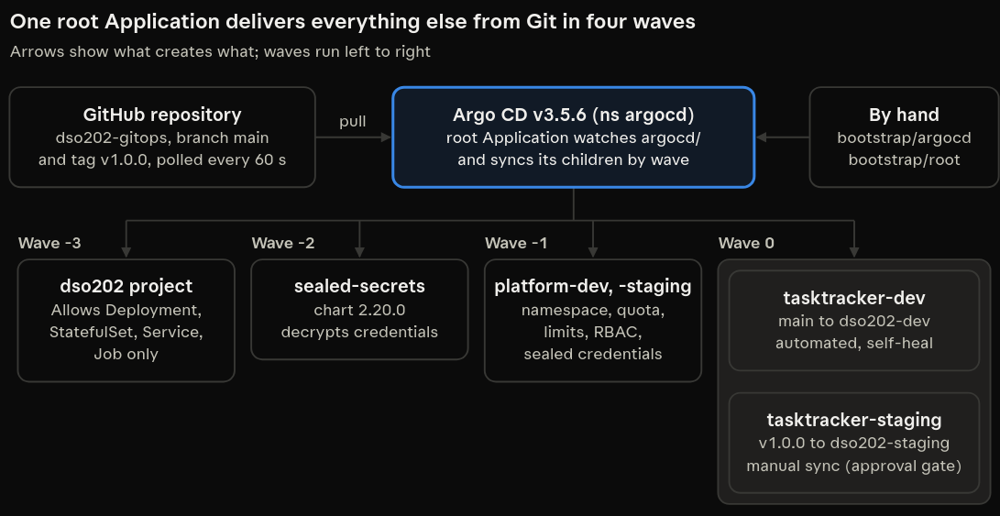

# GitOps Assignment Report (DSO202)

## Introduction

This assignment delivers the three-tier Task Tracker (PostgreSQL, Node.js backend, nginx frontend) to two environments, `dev` and `staging`, using Argo CD and GitOps.

After a two-step bootstrap, nothing reaches the cluster except through the Git repository [dso202-gitops](https://github.com/Khemraj9815/dso202-gitops). Argo CD runs inside the cluster, polls the repository every 60 s and makes the cluster match it.

**Objectives**

- Install Argo CD declaratively and bootstrap everything else from one root Application (app of apps).
- Package the application as one Helm chart. Keep every environment difference in `environments/<env>/values.yaml`.
- Keep credentials out of Git in plain form by using Sealed Secrets.
- Separate the platform layer (namespaces, quotas, RBAC) from the workload layer, and enforce that split with AppProjects.
- Run dev on automated sync with self-heal. Gate staging behind a Git tag and a manual sync.
- Prove the GitOps principles with drift, prune and permission drills, then rebuild the whole environment from an empty cluster.

## Architecture

Only cluster and argoCD are made by hand. Everything else is created by Argo CD from Git, in sync waves, so dependencies come up in the right order.

## Task Implementation

| Task | What was built | Key result |
| --- | --- | --- |
| 1. Chart and cluster | Helm chart `charts/tasktracker` meeting contract C1 to C11; per-env values; two-node kind cluster | `helm lint` clean for both envs; chart renders only 2 Deployments, 3 Services, 1 StatefulSet |
| 2. Argo CD install | Kustomize over the pinned upstream v3.5.6 manifest, with `argocd-cm` and `argocd-rbac-cm` patches | 7 Argo CD pods Running; reconciliation 60 s + 10 s jitter; server and CLI both v3.5.6 |
| 3. Projects and root | `platform` project and `root` Application applied by hand; `dso202` project delivered from Git | `dso202` appears in the root's resource list; whitelist cut to Deployment, StatefulSet, Service, Job |
| 4. Platform layer and secrets | Sealed Secrets chart 2.20.0 via Argo CD; namespaces, quota, limits, RBAC, sealed credentials per env | 16 history searches (4 keys x 2 envs x plain/base64) found no credential |
| 5. Workloads | `tasktracker-dev` (main, automated) and `tasktracker-staging` (tag `v1.0.0`, manual); PostSync smoke-test Job | Waves ran DB, backend, frontend, then smoke test in 24 s; CRUD works in both envs |
| 6. Argo CD RBAC | Local `reviewer` account; read-only policy on project `dso202`; logs rule added by commit | Sync denied, `platform` project denied; logs API HTTP 200 for dev, 403 for `root` |
| 7. Release and rollback | Not run: `rynorbu11/dso202-{frontend,backend}:1.1` do not exist on Docker Hub | Staging stays at `v1.0.0`; Q5 answered from documented behaviour |
| 8. Drills | Four drills, each predicted before running | All four predictions held |
| 9. Rebuild | Deleted the cluster, restored the sealing key, ran only the two bootstrap steps | Working dev frontend in about 3 min 45 s; full rebuild with staging in 4 min 48 s |

**Task 5 wave order (dev).** Each wave started only after the previous one was ready:

1. Database ready at 08:22:57, backend created at the same second.
2. Backend ready at 08:23:03, frontend created.
3. Frontend ready at 08:23:09, PostSync smoke-test Job created.
4. Smoke test completed at 08:23:12 and returned the three seed tasks.

**Task 6 known limitation.** The logs permission works at the API, but no Pod logs appear in the UI. Argo CD hides tree nodes whose kind the project does not permit. The `dso202` whitelist omits `ReplicaSet` and `Pod`, so the Pods are not in the tree. Adding those two kinds would fix it; I left the whitelist equal to what the chart renders.

## Drills and rebuild evidence

All four Task 8 predictions, written at 09:45:48 before any drill ran, held. The Task 9 rebuild then showed the repository alone can recreate both environments.

| Drill | Action | Observed | Principle shown |
| --- | --- | --- | --- |
| 1. Drift in dev | Scaled `tasktracker-backend` in `dso202-dev` to 3 replicas at 09:46:08 | Back to 1 replica by 09:46:14 (6 s); self-heal added history entry 1 | Continuously reconciled (`selfHeal: true`) |
| 2. Drift in staging | Same scale in `dso202-staging` at 09:46:58 | Still 3/3 after 75 s; reported `OutOfSync` with diff `replicas: 3` vs `1`; manual sync restored 1 | Manual gate: Argo CD observes but only a person applies |
| 3. Prune | Added `prune-drill` ConfigMap (`06d883c`), then removed it (`8c4fb5d`) | Created within 45 s with no manual refresh; deleted after removal | Git is the complete description (`prune: true`) |
| 4. Project boundary | Added a `ResourceQuota` to the workload chart (`d6ce000`) | Sync refused: `resource :ResourceQuota is not permitted in project dso202`; nothing applied; staging untouched | Least privilege; recovered with `git revert` (`f374da6`) |

**Lesson learned from the drills.**

- *Argo CD syncs to the state of Git when it polls, not to every commit.* The first prune attempt pushed the add and the removal 34 s apart. Both landed before the next poll, so the ConfigMap was never created. The drill was repeated with a pause between pushes.
- *Namespaces are protected from prune.* Each `namespace.yaml` carries `Prune=false`. Deleting that file would otherwise delete the namespace and all data in it, including the database volume.

The controller log shows it registered the restored key `sealed-secrets-key4bvlx`, so both SealedSecrets decrypted without resealing. The database contents were reset to the three seed tasks, as expected: data is state, not configuration.

## Answers

These are short versions. The full answers, with listings, are in `README.md`.

### Q1. Why is `platform` applied by hand but `dso202` delivered by the root?

The root Application must belong to a project that already exists. Argo CD cannot deliver the project that authorises its own delivery, so `platform` is part of the manual bootstrap. Every other project, including `dso202`, is ordinary desired state in `argocd/projects/`, so it is versioned and recreated on rebuild.

If `dso202` could deploy into the `argocd` namespace, a workload commit could create an Application with `project: platform` or edit its own AppProject. That would escape the whitelist and give cluster-wide access. Write access to `argocd` is effectively admin access.

### Q2. What does strict scope prevent, and what if the sealing key is lost?

Strict scope mixes the Secret's name and namespace into the encryption. A copied or renamed SealedSecret will not decrypt in another namespace, so the dev file is useless in `dso202-staging`.

If the key is lost, every SealedSecret in Git becomes permanent ciphertext, and a new controller reports `no key could decrypt secret`. Recovery: take the values from the password manager (or rotate them, including inside Postgres), reseal against the new public key, commit, and back up the new key at once. The controller renews its key every 30 days, so backups must be repeated.

### Q3. What is the difference between Synced and Healthy?

*Synced* means the live objects equal what Git renders. *Healthy* means those objects actually work. At 08:23:04 `tasktracker-dev` was `Synced` but `Progressing`, because the frontend Pod was not yet ready; it became `Healthy` at 08:23:09.

### Q4. How does Argo CD RBAC differ from Kubernetes RBAC?

|  | Argo CD RBAC | Kubernetes RBAC |
| --- | --- | --- |
| Controls | Users of the Argo CD UI, CLI and API acting on Applications, Projects, logs | Identities calling the Kubernetes API directly |
| Configured in | `argocd-rbac-cm` (`policy.csv`) and `argocd-cm` accounts | Role, ClusterRole and their bindings |
| Example here | `p, reviewer, applications, get, dso202/*, allow` | `dso202-developers` may read Pods and logs in `dso202-dev` |

The two are independent: `reviewer` reads logs through Argo CD with no Kubernetes binding. With SSO, local accounts are removed and `policy.csv` grants roles to identity-provider groups (`g, my-org:dso202-reviewers, role:dso202-reviewer`), so membership is managed in the identity provider.

### Q5. Why is `argocd app rollback` refused, and what is the GitOps equivalent?

Task 7 did not run, so this answer is from documented Argo CD v3.5 behaviour. Rollback applies an old revision directly, which makes the cluster differ from `main`. With automated sync, the controller would undo it at once, so Argo CD refuses rollback on automated Applications.

The GitOps equivalent is `git revert <bad-commit>`, which Argo CD then syncs like any release. Drill 4 used exactly this (`d6ce000` reverted by `f374da6`). A revert is preferred to deleting the commit because `main` is shared: rewriting it breaks every clone, while a revert keeps an append-only, auditable history.

### Q6. One repository, and what stays outside GitOps

**(a) Chart and configuration in one repository.**

- *For:* a chart change and its values land in one commit, and one `git revert` undoes both. One clone and one history kept Task 9 simple.
- *Against:* every commit is a new revision for apps that follow `main`, and a staging tag pins chart and config together, so they cannot be promoted separately. Access is all-or-nothing: whoever can change the chart can also change staging values and Argo CD objects.

**(b) Not under GitOps control after the rebuild.**

| Item | Why it is outside | Usual practice |
| --- | --- | --- |
| Argo CD install (`bootstrap/argocd`) | In Git but applied by hand | Let Argo CD manage itself, or install with Terraform |
| Root Application and `platform` project | Applied once by hand; not self-healed | Create from provisioning automation; tight RBAC on `argocd` |
| Sealing key | Lives only in the cluster and a manual backup | Secret manager or KMS, or External Secrets with Vault |
| Database contents | Data is state, not configuration | Scheduled `pg_dump` or Velero snapshots, tested restores |
| kind cluster, reviewer password | Created or set by hand | Infrastructure as code; SSO instead of local accounts |

## 6. Challenges, lessons learned and conclusion

**Challenges and how I handled them**

| Challenge | Fix or outcome |
| --- | --- |
| ApplicationSet CRD too large for client-side `kubectl apply` | Installed Argo CD with `--server-side --force-conflicts` |
| Unreliable network for image pulls | Imported 8 cached images into both nodes with `docker save` and `ctr images import`; `kind load` in v0.20.0 cannot detect the v1.36 node snapshotter |
| `1.1` release images not published | Task 7 not run; documented with the Docker Hub tag listing, and Q5 answered from documented behaviour |
| Prune drill pushes landed inside one poll interval | Repeated with a pause between the add and the removal |
| Reviewer UI shows no Pod logs | Traced to the project whitelist hiding `Pod` and `ReplicaSet`; fix identified, left unapplied |
| Keeping credentials out of Git and the shell history | Plaintext typed in an editor, piped through `kubeseal` without touching disk, then deleted; key backed up outside the repo (mode 600) |

**Lessons learned**

- *Git as the only path is what makes recovery fast.* The rebuild needed two manual commands and under 5 minutes, because every other object was already in Git.
- *Automation and approval are a per-environment choice.* The same reconciliation loop reverts drift in dev but only reports it in staging. A tag plus a manual sync is a simple, auditable promotion gate.
- *AppProjects turn least privilege into a hard rule.* A wrong commit to the chart cannot loosen its own limits, whoever makes it.
- *Secrets need a lifecycle, not just encryption.* Sealed Secrets keeps Git safe, but the sealing key becomes the single critical item to back up after every rebuild and renewal.

**Conclusion**  
I was able to meet the GitOps principles where the desired or declarative version in Git was able to sync with the cluster with the help of argocd. I learned a lot of stuff while doing this assignment and what i really love about this assignment was the argocd which makes our works easier. We just need to declare desired state of the cluster and push it to the Git. ArgoCD is powerful tool what reconcile every time with the Git.

**References**

- Evidence: `docs/evidence.md`; written answers: `README.md`
- Pinned versions: Argo CD v3.5.6, Sealed Secrets chart 2.20.0 (controller 0.40.0), kind v0.20.0 with node v1.36.1, Helm v4.3.0
- <https://medium.com/@muppedaanvesh/a-hands-on-guide-to-argocd-on-kubernetes-part-1-%EF%B8%8F-7a80c1b0ac98>
