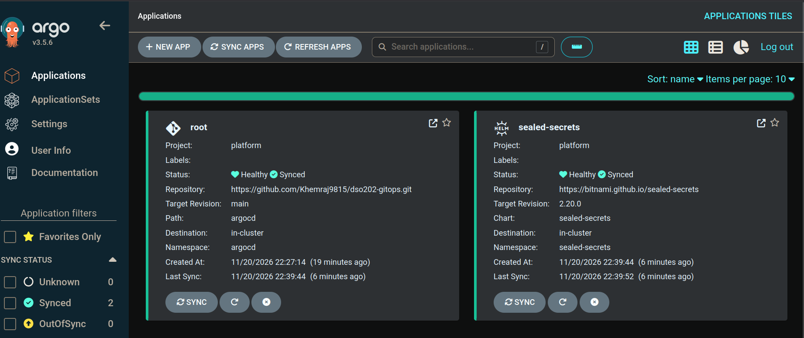
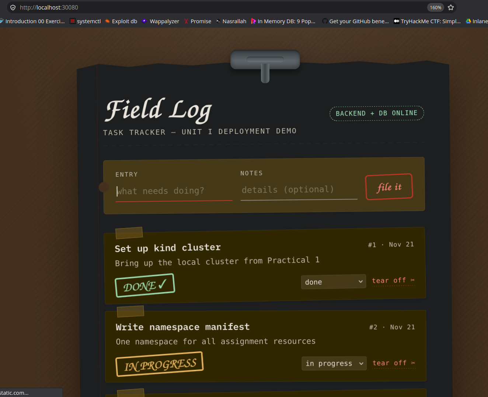
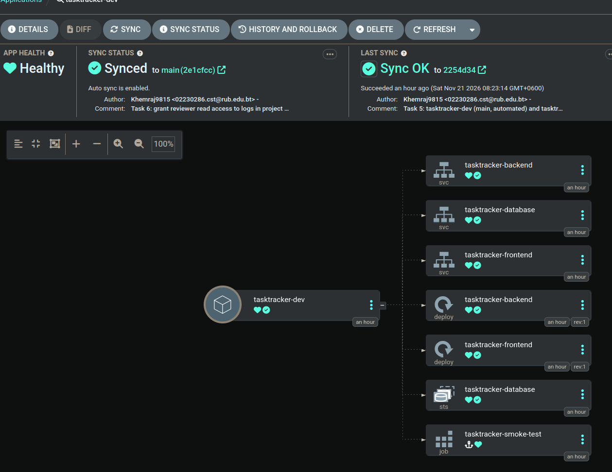

<!--
=============================================================================
File        : docs/evidence.md
Assignment  : DSO202 Assignment 4
Descriptor  : Section 9 - evidence convention
Purpose     : Command output for every task, one heading per task. Each block
              shows the command that was run, then its output. Credential
              values and key material never appear here.
=============================================================================
-->
# Evidence - dso202-gitops

## Task 1

### 1.1 Tool check (section 3.2)
```text
$ docker version --format '{{.Server.Version}}'
28.4.0

$ kind version
kind v0.20.0 go1.20.4 linux/amd64

$ kubectl version --client
Client Version: v1.34.1
Kustomize Version: v5.7.1

$ helm version --short
v4.3.0+gbec5b06

$ git --version
git version 2.43.0

$ argocd version --client
argocd: v3.5.6+c2b1e30
  BuildDate: 2026-10-20T19:01:52Z
  GitCommit: c2b1e3017e2cec86b122172e861dcd026453ae44
  GitTreeState: clean
  GoVersion: go1.26.10
  Compiler: gc
  Platform: linux/amd64

$ kubeseal --version
kubeseal version: 0.40.0

$ helm repo add sealed-secrets https://bitnami.github.io/sealed-secrets
"sealed-secrets" has been added to your repositories

$ helm repo update sealed-secrets
Hang tight while we grab the latest from your chart repositories...
...Successfully got an update from the "sealed-secrets" chart repository
Update Complete. ⎈Happy Helming!⎈

$ helm search repo sealed-secrets/sealed-secrets --versions | head -5
NAME                         	CHART VERSION	APP VERSION	DESCRIPTION                                  
sealed-secrets/sealed-secrets	2.22.0       	0.41.2     	Helm chart for the sealed-secrets controller.
sealed-secrets/sealed-secrets	2.21.0       	0.41.2     	Helm chart for the sealed-secrets controller.
sealed-secrets/sealed-secrets	2.20.0       	0.40.0     	Helm chart for the sealed-secrets controller.
sealed-secrets/sealed-secrets	2.19.3       	0.39.1     	Helm chart for the sealed-secrets controller.

```

### 1.2 Chart contract
| # | Requirement | Where it is satisfied (file → key) |
|---|---|---|
| C1 | Image repository and tag are values per tier | `charts/tasktracker/values.yaml` → `database/backend/frontend.image.repository`, `.image.tag`; used in `templates/database-statefulset.yaml`, `backend-deployment.yaml`, `frontend-deployment.yaml`. No tag appears in any template. |
| C2 | Per-tier configuration from values | `values.yaml` → `<tier>.env` (a map, so an environment file can add one key without repeating the others); rendered by `templates/_helpers.tpl` → `tasktracker.env` |
| C3 | No `Secret` rendered; credentials from `existingSecret` | `values.yaml` → `existingSecret: tasktracker-credentials`, `<tier>.secretEnv`; `_helpers.tpl` → `secretKeyRef.name`. No template renders `kind: Secret`. |
| C4 | Readiness probes on all three tiers | `values.yaml` → `database.readinessProbe` (`pg_isready`), `backend.readinessProbe` (`GET /api/status`), `frontend.readinessProbe` (`GET /`) |
| C5 | Sync waves database 0, backend 1, frontend 2 | `values.yaml` → `<tier>.syncWave`; `metadata.annotations["argocd.argoproj.io/sync-wave"]` in each workload template |
| C6 | `progressDeadlineSeconds: 120` | `values.yaml` → `backend/frontend.progressDeadlineSeconds`; `spec.progressDeadlineSeconds` in both Deployment templates |
| C7 | Requests and limits on every container | `values.yaml` → `<tier>.resources`; smoke-test Job declares its own (Task 5) |
| C8 | No Namespace/ResourceQuota/LimitRange/Role/RoleBinding in the chart | rendered kinds in 1.3 are only Deployment, Service, StatefulSet; those kinds live in `platform/<env>/` |
| C9 | Ingress disabled by default | `values.yaml` → `ingress.enabled: false`; `templates/ingress.yaml` wrapped in `if .Values.ingress.enabled` |
| C10 | Frontend Service is NodePort, port is a value | `values.yaml` → `frontend.service.type: NodePort`, `frontend.service.nodePort`; `environments/dev/values.yaml` 30080, `environments/staging/values.yaml` 30081 |
| C11 | `helm lint` clean, `helm template` succeeds | see 1.3 |

### 1.3 helm lint and rendered kinds
```text
$ helm lint charts/tasktracker -f environments/dev/values.yaml
==> Linting charts/tasktracker
[INFO] Chart.yaml: icon is recommended

1 chart(s) linted, 0 chart(s) failed

$ helm lint charts/tasktracker -f environments/staging/values.yaml
==> Linting charts/tasktracker
[INFO] Chart.yaml: icon is recommended

1 chart(s) linted, 0 chart(s) failed

$ helm template tasktracker charts/tasktracker -f environments/dev/values.yaml | grep '^kind:' | sort | uniq -c
      2 kind: Deployment
      3 kind: Service
      1 kind: StatefulSet

```

### 1.4 Cluster
```text
$ kind get clusters
dso202-gitops

$ kubectl config current-context
kind-dso202-gitops

$ kubectl get nodes
NAME            STATUS   ROLES           AGE     VERSION
control-plane   Ready    control-plane   3m4s    v1.36.1
worker-node-1   Ready    <none>          2m54s   v1.36.1

$ docker ps --filter name=dso202-gitops --format '{{.Names}}   {{.Ports}}'
dso202-gitops-worker   
dso202-gitops-control-plane   127.0.0.1:30080->30080/tcp, 127.0.0.1:30090->30090/tcp, 127.0.0.1:39157->6443/tcp

```

The last line shows host port 30080 (dev frontend) and 30090 (dev backend API) mapped on the control-plane node.

## Task 2

### 2.1 Render checks, install, pods, CRDs, local settings, version
```text
$ kubectl kustomize bootstrap/argocd | grep -E '^kind: (Deployment|StatefulSet)$' | sort | uniq -c
      6 kind: Deployment
      1 kind: StatefulSet

$ kubectl kustomize bootstrap/argocd | grep 'image:' | sort -u
        image: ghcr.io/dexidp/dex:v2.45.1
        image: public.ecr.aws/docker/library/redis:8.2.3-alpine
        image: quay.io/argoproj/argocd:v3.5.6

$ kubectl wait --for=condition=Available deployment --all -n argocd --timeout=300s
deployment.apps/argocd-applicationset-controller condition met
deployment.apps/argocd-dex-server condition met
deployment.apps/argocd-notifications-controller condition met
deployment.apps/argocd-redis condition met
deployment.apps/argocd-repo-server condition met
deployment.apps/argocd-server condition met

$ kubectl rollout status statefulset/argocd-application-controller -n argocd --timeout=300s
partitioned roll out complete: 1 new pods have been updated...

$ kubectl get pods -n argocd
NAME                                                READY   STATUS    RESTARTS   AGE
argocd-application-controller-0                     1/1     Running   0          38s
argocd-applicationset-controller-58bb5c7479-kx2r2   1/1     Running   0          48s
argocd-dex-server-dd6b85d9c-9n8rl                   1/1     Running   0          48s
argocd-notifications-controller-6b85c65458-t6s4q    1/1     Running   0          48s
argocd-redis-869b85489d-kngpg                       1/1     Running   0          48s
argocd-repo-server-5bf66565cd-25rlv                 1/1     Running   0          48s
argocd-server-7474bb8f76-8wrxf                      1/1     Running   0          48s

$ kubectl get crd | grep argoproj.io
applications.argoproj.io      2026-11-20T14:51:17Z
applicationsets.argoproj.io   2026-11-20T14:51:17Z
appprojects.argoproj.io       2026-11-20T14:51:18Z

$ kubectl get configmap argocd-cm -n argocd -o yaml | grep -E 'timeout.reconciliation|accounts.reviewer'
  accounts.reviewer: login
  timeout.reconciliation: 60s
  timeout.reconciliation.jitter: 10s

$ argocd admin initial-password -n argocd
<password printed - not recorded>

$ argocd login localhost:8080 --username admin --insecure
'admin:login' logged in successfully

$ argocd version
argocd: v3.5.6+c2b1e30
  BuildDate: 2026-10-20T19:01:52Z
  GitCommit: c2b1e3017e2cec86b122172e861dcd026453ae44
  GitTreeState: clean
  GoVersion: go1.26.10
  Compiler: gc
  Platform: linux/amd64
argocd-server: v3.5.6
  BuildDate: 2026-10-20T18:33:20Z
  GitCommit: c2b1e3017e2cec86b122172e861dcd026453ae44
  GitTreeState: clean
  GitTag: v3.5.6
  GoVersion: go1.26.10
  Compiler: gc
  Platform: linux/amd64
  Kustomize Version: v5.8.1 2026-02-09T16:15:27Z
  Helm Version: v4.2.1+gd591a19
  Kubectl Version: v0.36.1
  Jsonnet Version: v0.22.0

```

### 2.2 Screenshot


## Task 3

### 3.1 Whitelist compared with the chart
Rendered kinds (Task 1, 1.3): `Deployment` x2, `Service` x3, `StatefulSet` x1, plus the PostSync `Job` (Task 5).
Final `namespaceResourceWhitelist` in `argocd/projects/dso202.yaml`: `apps/Deployment`, `apps/StatefulSet`, `""/Service`, `batch/Job`.
Change from Listing 8: `ConfigMap` and `ServiceAccount` **removed** (the chart renders neither; a wider whitelist than needed is unused privilege). Nothing added. `Namespace`, `ResourceQuota`, `LimitRange`, `Role`, `RoleBinding`, `SealedSecret` are absent, as required.

### 3.2 Bootstrap and result
```text
$ kubectl apply -f bootstrap/root
appproject.argoproj.io/platform unchanged
application.argoproj.io/root unchanged

$ kubectl get appproject,application -n argocd
NAME                              AGE
appproject.argoproj.io/default    62s
appproject.argoproj.io/dso202     10s
appproject.argoproj.io/platform   15s

NAME                           SYNC STATUS   HEALTH STATUS
application.argoproj.io/root   Synced        Healthy

$ argocd app get root
Name:               argocd/root
Project:            platform
Server:             https://kubernetes.default.svc
Namespace:          argocd
URL:                https://localhost:8080/applications/root
Source:
- Repo:             https://github.com/Khemraj9815/dso202-gitops.git
  Target:           main
  Path:             argocd
SyncWindow:         Sync Allowed
Sync Policy:        Automated (Prune)
Sync Status:        Synced to main (e2cfff4)
Health Status:      Healthy

GROUP        KIND        NAMESPACE  NAME    STATUS  HEALTH  HOOK  MESSAGE
argoproj.io  AppProject  argocd     dso202  Synced                appproject.argoproj.io/dso202 unchanged

$ argocd proj get dso202
Name:                        dso202
Description:                 Task Tracker workloads for the dev and staging environments
Destinations:                https://kubernetes.default.svc,dso202-dev
                             https://kubernetes.default.svc,dso202-staging
Repositories:                https://github.com/Khemraj9815/dso202-gitops.git
Source Namespaces:           <none>
Scoped Repositories:         <none>
Allowed Cluster Resources:   <none>
Scoped Clusters:             <none>
Denied Namespaced Resources: <none>
Signature keys:              <none>
Orphaned Resources:          disabled

```
`dso202` appears in the resource list of `root`: it was created by the root Application, not by hand.

### 3.3 Screenshot


## Task 4

### 4.1 Controller installed from Git (step 1)
```text
$ kubectl get applications -n argocd
NAME             SYNC STATUS   HEALTH STATUS
root             Synced        Healthy
sealed-secrets   Synced        Healthy

$ kubectl get pods -n sealed-secrets
NAME                                        READY   STATUS    RESTARTS   AGE
sealed-secrets-controller-8b5ffdf69-fcdnq   1/1     Running   0          13s

$ kubectl get crd sealedsecrets.bitnami.com
NAME                        CREATED AT
sealedsecrets.bitnami.com   2026-11-20T16:39:50Z

```

### 4.2 Sealing-key backup (step 2) - existence and permissions only
```text
$ ls -l ../dso202-keys/
total 8
-rw------- 1 khemrajghalley khemrajghalley 7088 Nov 20 22:40 sealing-key.backup.yaml

$ grep -c 'tls.key' ../dso202-keys/sealing-key.backup.yaml
1

```
The backup is outside the repository, mode 600, and taken before anything was sealed. Its contents are never shown.

### 4.3 Sealing (steps 3-4)
Plaintext inputs `secrets-plain/dev.env` and `secrets-plain/staging.env` were written in an editor (mode 600, ignored by Git), checked for matching `DB_*`/`POSTGRES_*` values and for different dev/staging passwords, then sealed per namespace:
```bash
export SEALED_SECRETS_CONTROLLER_NAMESPACE=sealed-secrets
kubectl create secret generic tasktracker-credentials --namespace dso202-dev \
  --from-env-file=secrets-plain/dev.env --dry-run=client -o yaml \
  | kubeseal --format yaml > platform/dev/tasktracker-credentials.sealed.yaml
# repeated with dso202-staging / secrets-plain/staging.env / platform/staging/...
```

### 4.4 Platform layer delivered (step 6)
```text
$ kubectl get applications -n argocd
NAME               SYNC STATUS   HEALTH STATUS
platform-dev       Synced        Healthy
platform-staging   Synced        Healthy
root               Synced        Healthy
sealed-secrets     Synced        Healthy

$ kubectl get namespaces | grep dso202
dso202-dev           Active   8h
dso202-staging       Active   8h

$ kubectl get sealedsecret -n dso202-dev
NAME                      STATUS   SYNCED   AGE
tasktracker-credentials            True     8h

$ kubectl describe secret tasktracker-credentials -n dso202-dev
Name:         tasktracker-credentials
Namespace:    dso202-dev
Labels:       <none>
Annotations:  <none>

Type:  Opaque

Data
====
DB_PASSWORD:        6 bytes
DB_USER:            6 bytes
POSTGRES_PASSWORD:  6 bytes
POSTGRES_USER:      6 bytes

$ kubectl get resourcequota,limitrange,role,rolebinding -n dso202-dev
NAME                               REQUEST                                                LIMIT                                   AGE
resourcequota/app-resource-quota   pods: 0/8, requests.cpu: 0/2, requests.memory: 0/2Gi   limits.cpu: 0/4, limits.memory: 0/4Gi   8h

NAME                         CREATED AT
limitrange/app-limit-range   2026-11-20T16:56:19Z

NAME                                                CREATED AT
role.rbac.authorization.k8s.io/tasktracker-viewer   2026-11-20T16:56:19Z

NAME                                                               ROLE                      AGE
rolebinding.rbac.authorization.k8s.io/tasktracker-viewer-binding   Role/tasktracker-viewer   8h

$ kubectl get sealedsecret -n dso202-staging
NAME                      STATUS   SYNCED   AGE
tasktracker-credentials            True     8h

$ kubectl describe secret tasktracker-credentials -n dso202-staging
Name:         tasktracker-credentials
Namespace:    dso202-staging
Labels:       <none>
Annotations:  <none>

Type:  Opaque

Data
====
DB_PASSWORD:        9 bytes
DB_USER:            9 bytes
POSTGRES_PASSWORD:  9 bytes
POSTGRES_USER:      9 bytes

$ kubectl get resourcequota,limitrange,role,rolebinding -n dso202-staging
NAME                               REQUEST                                                LIMIT                                   AGE
resourcequota/app-resource-quota   pods: 0/8, requests.cpu: 0/2, requests.memory: 0/2Gi   limits.cpu: 0/4, limits.memory: 0/4Gi   8h

NAME                         CREATED AT
limitrange/app-limit-range   2026-11-20T16:56:20Z

NAME                                                CREATED AT
role.rbac.authorization.k8s.io/tasktracker-viewer   2026-11-20T16:56:20Z

NAME                                                               ROLE                      AGE
rolebinding.rbac.authorization.k8s.io/tasktracker-viewer-binding   Role/tasktracker-viewer   8h

$ argocd app get platform-dev
{"level":"fatal","msg":"Failed to establish connection to localhost:8080: error dial proxy: dial tcp 127.0.0.1:8080: connect: connection refused","time":"2026-11-21T07:50:47+06:00"}

```
Both `platform-*` Applications are `Synced` and `Healthy`; `tasktracker-credentials` exists in both namespaces with the four keys (sizes only, never values), created by the controller from the SealedSecret.

### 4.5 No plaintext in Git history (step 7)
Keys tested, in both environments, each in plain **and** base64 form: `DB_USER`, `DB_PASSWORD`, `POSTGRES_USER`, `POSTGRES_PASSWORD` (16 searches). Values are not recorded.
```text
$ git log -p --all -S'<dev DB_USER, plain>' | head
(no output)
$ git log -p --all -S'<dev DB_USER, base64>' | head
(no output)
$ git log -p --all -S'<dev DB_PASSWORD, plain>' | head
(no output)
$ git log -p --all -S'<dev DB_PASSWORD, base64>' | head
(no output)
$ git log -p --all -S'<dev POSTGRES_USER, plain>' | head
(no output)
$ git log -p --all -S'<dev POSTGRES_USER, base64>' | head
(no output)
$ git log -p --all -S'<dev POSTGRES_PASSWORD, plain>' | head
(no output)
$ git log -p --all -S'<dev POSTGRES_PASSWORD, base64>' | head
(no output)
$ git log -p --all -S'<staging DB_USER, plain>' | head
(no output)
$ git log -p --all -S'<staging DB_USER, base64>' | head
(no output)
$ git log -p --all -S'<staging DB_PASSWORD, plain>' | head
(no output)
$ git log -p --all -S'<staging DB_PASSWORD, base64>' | head
(no output)
$ git log -p --all -S'<staging POSTGRES_USER, plain>' | head
(no output)
$ git log -p --all -S'<staging POSTGRES_USER, base64>' | head
(no output)
$ git log -p --all -S'<staging POSTGRES_PASSWORD, plain>' | head
(no output)
$ git log -p --all -S'<staging POSTGRES_PASSWORD, base64>' | head
(no output)

$ git status --short --ignored
 M docs/evidence.md
!! secrets-plain/
```
Every search printed nothing. The only ignored path is `secrets-plain/`.

### 4.6 Screenshot: the controller Application, created by the root from Git



## Task 5

### 5.1 Baseline tag
```text
$ git ls-remote --tags origin
a354888643ae0f50a400cf7939ae61e5b067dca2	refs/tags/v1.0.0
c512c4580b20734a12afb73f1d4dac3fe9fb6aca	refs/tags/v1.0.0^{}
```
`v1.0.0` points at `c512c45` ("Task 5: PostSync smoke-test hook"), which contains the chart, the smoke test and `environments/staging/values.yaml`. The Applications were added in the next commit (`2254d34`).

### 5.2 Wave order in dev (step 4)
`kubectl get pods -n dso202-dev -w`, each line prefixed with the time it was printed (repeated lines removed):
```text
08:22:48 NAME                     READY   STATUS    RESTARTS   AGE
08:22:48 tasktracker-database-0   0/1     Pending   0          0s
08:22:51 tasktracker-database-0   0/1     ContainerCreating   0          3s
08:22:52 tasktracker-database-0   0/1     Running             0          4s
08:22:57 tasktracker-database-0   1/1     Running             0          9s
08:22:57 tasktracker-backend-797ccb7c6c-xw47n   0/1     Pending             0          0s
08:22:58 tasktracker-backend-797ccb7c6c-xw47n   0/1     ContainerCreating   0          1s
08:22:58 tasktracker-backend-797ccb7c6c-xw47n   0/1     Running             0          1s
08:23:03 tasktracker-backend-797ccb7c6c-xw47n   1/1     Running             0          6s
08:23:03 tasktracker-frontend-66ccd9ff45-vzpqm   0/1     Pending             0          0s
08:23:04 tasktracker-frontend-66ccd9ff45-vzpqm   0/1     ContainerCreating   0          0s
08:23:04 tasktracker-frontend-66ccd9ff45-vzpqm   0/1     Running             0          1s
08:23:09 tasktracker-frontend-66ccd9ff45-vzpqm   1/1     Running             0          6s
08:23:09 tasktracker-smoke-test-7bxng            0/1     Pending             0          0s
08:23:09 tasktracker-smoke-test-7bxng            0/1     ContainerCreating   0          0s
08:23:11 tasktracker-smoke-test-7bxng            1/1     Running             0          2s
08:23:12 tasktracker-smoke-test-7bxng            0/1     Completed           0          3s
```
Each wave starts only when the previous one is **ready**: database ready 08:22:57 -> backend created 08:22:57; backend ready 08:23:03 -> frontend created 08:23:03; frontend ready 08:23:09 -> PostSync smoke-test Job created 08:23:09, completed 08:23:12.

`kubectl get applications -n argocd -w` over the same period (repeated lines removed):
```text
08:21:08 NAME               SYNC STATUS   HEALTH STATUS
08:21:08 platform-dev       Synced        Healthy
08:21:08 platform-staging   Synced        Healthy
08:21:08 root               Synced        Healthy
08:21:08 sealed-secrets     Synced        Healthy
08:22:40 root               OutOfSync     Healthy
08:22:47 tasktracker-dev                  
08:22:47 tasktracker-staging                 
08:22:47 root                  Synced        Progressing
08:22:48 tasktracker-dev       OutOfSync     Missing
08:22:48 tasktracker-staging   OutOfSync     Missing
08:22:48 tasktracker-dev       OutOfSync     Healthy
08:22:48 tasktracker-dev       OutOfSync     Progressing
08:23:04 tasktracker-dev       Synced        Progressing
08:23:09 tasktracker-dev       Synced        Healthy
08:24:01 tasktracker-staging   OutOfSync     Progressing
08:24:12 tasktracker-staging   OutOfSync     Healthy
08:24:18 tasktracker-staging   Synced        Progressing
08:24:24 tasktracker-staging   Synced        Healthy
```

### 5.3 Smoke test and dev Application
```text
$ kubectl get job -n dso202-dev
NAME                     STATUS     COMPLETIONS   DURATION   AGE
tasktracker-smoke-test   Complete   1/1           5s         17s

$ kubectl logs job/tasktracker-smoke-test -n dso202-dev
[{"id":1,"title":"Set up kind cluster","description":"Bring up the local cluster from Practical 1","status":"done","created_at":"2026-11-21T02:22:54.567Z"},{"id":2,"title":"Write namespace manifest","description":"One namespace for all assignment resources","status":"in_progress","created_at":"2026-11-21T02:22:54.567Z"},{"id":3,"title":"Wire ConfigMap and Secret","description":"DB_* and POSTGRES_* must carry matching values","status":"pending","created_at":"2026-11-21T02:22:54.567Z"}]
$ argocd app get tasktracker-dev
Name:               argocd/tasktracker-dev
Project:            dso202
Server:             https://kubernetes.default.svc
Namespace:          dso202-dev
URL:                https://localhost:8080/applications/tasktracker-dev
Source:
- Repo:             https://github.com/Khemraj9815/dso202-gitops.git
  Target:           main
  Path:             charts/tasktracker
  Helm Values:      ../../environments/dev/values.yaml
SyncWindow:         Sync Allowed
Sync Policy:        Automated (Prune)
Sync Status:        Synced to main (2254d34)
Health Status:      Healthy

GROUP  KIND         NAMESPACE   NAME                    STATUS     HEALTH   HOOK      MESSAGE
       Service      dso202-dev  tasktracker-database    Synced     Healthy            service/tasktracker-database created
apps   StatefulSet  dso202-dev  tasktracker-database    Synced     Healthy            statefulset rolling update complete 1 pods at revision tasktracker-database-6b756cf8f4...
       Service      dso202-dev  tasktracker-backend     Synced     Healthy            service/tasktracker-backend created
apps   Deployment   dso202-dev  tasktracker-backend     Synced     Healthy            deployment.apps/tasktracker-backend created
       Service      dso202-dev  tasktracker-frontend    Synced     Healthy            service/tasktracker-frontend created
apps   Deployment   dso202-dev  tasktracker-frontend    Synced     Healthy            deployment.apps/tasktracker-frontend created
batch  Job          dso202-dev  tasktracker-smoke-test  Succeeded  Synced   PostSync  Reached expected number of succeeded pods

```

### 5.4 CRUD cycle in dev (backend API at http://localhost:30090, the address the frontend at http://localhost:30080 calls)
```text
$ curl -s -o /dev/null -w 'frontend HTTP %{http_code}\n' http://localhost:30080/
frontend HTTP 200

$ curl -s http://localhost:30080/config.js
// Rendered at container start by docker-entrypoint.sh via envsubst.
// Static assets can't read environment variables at request time, so the
// real value gets baked into config.js once, right before nginx starts.
window.__CONFIG__ = {
  BACKEND_URL: "http://localhost:30090"
};

$ curl -s http://localhost:30090/api/status
{"status":"ok","db":"connected"}
$ curl -s -X POST -H 'Content-Type: application/json' -d '{"title":"CRUD test (Task 5)","description":"created through the dev API"}' http://localhost:30090/api/tasks
{"id":4,"title":"CRUD test (Task 5)","description":"created through the dev API","status":"pending","created_at":"2026-11-21T02:23:26.908Z"}
$ curl -s http://localhost:30090/api/tasks/4
{"id":4,"title":"CRUD test (Task 5)","description":"created through the dev API","status":"pending","created_at":"2026-11-21T02:23:26.908Z"}
$ curl -s -X PUT -H 'Content-Type: application/json' -d '{"title":"CRUD test (Task 5)","status":"done"}' http://localhost:30090/api/tasks/4
{"id":4,"title":"CRUD test (Task 5)","description":"created through the dev API","status":"done","created_at":"2026-11-21T02:23:26.908Z"}
$ curl -s -o /dev/null -w 'DELETE HTTP %{http_code}\n' -X DELETE http://localhost:30090/api/tasks/4
DELETE HTTP 204

$ curl -s -o /dev/null -w 'GET after delete HTTP %{http_code}\n' http://localhost:30090/api/tasks/4
GET after delete HTTP 404

```
Create (201, id 4) -> read -> update (status `done`) -> delete (204) -> read again (404). The cycle was also used in the browser at http://localhost:30080: the page reports "Backend + DB online" and task #5 was filed through the UI.




### 5.5 Staging: before the first sync
```text
$ kubectl get applications -n argocd
NAME                  SYNC STATUS   HEALTH STATUS
platform-dev          Synced        Healthy
platform-staging      Synced        Healthy
root                  Synced        Healthy
sealed-secrets        Synced        Healthy
tasktracker-dev       Synced        Healthy
tasktracker-staging   OutOfSync     Missing

$ argocd app get tasktracker-staging
Name:               argocd/tasktracker-staging
Project:            dso202
Server:             https://kubernetes.default.svc
Namespace:          dso202-staging
URL:                https://localhost:8080/applications/tasktracker-staging
Source:
- Repo:             https://github.com/Khemraj9815/dso202-gitops.git
  Target:           v1.0.0
  Path:             charts/tasktracker
  Helm Values:      ../../environments/staging/values.yaml
SyncWindow:         Sync Allowed
Sync Policy:        Manual
Sync Status:        OutOfSync from v1.0.0 (c512c45)
Health Status:      Missing

GROUP  KIND         NAMESPACE       NAME                  STATUS     HEALTH   HOOK  MESSAGE
       Service      dso202-staging  tasktracker-backend   OutOfSync  Missing        
       Service      dso202-staging  tasktracker-database  OutOfSync  Missing        
       Service      dso202-staging  tasktracker-frontend  OutOfSync  Missing        
apps   Deployment   dso202-staging  tasktracker-backend   OutOfSync  Missing        
apps   Deployment   dso202-staging  tasktracker-frontend  OutOfSync  Missing        
apps   StatefulSet  dso202-staging  tasktracker-database  OutOfSync  Missing        

$ argocd app get root | sed -n '/Health Status/,$p'
Health Status:      Healthy

GROUP        KIND         NAMESPACE  NAME                 STATUS  HEALTH   HOOK  MESSAGE
argoproj.io  Application  argocd     tasktracker-staging  Synced  Missing        application.argoproj.io/tasktracker-staging unchanged
argoproj.io  Application  argocd     tasktracker-dev      Synced  Healthy        application.argoproj.io/tasktracker-dev unchanged
argoproj.io  AppProject   argocd     dso202               Synced                 
argoproj.io  Application  argocd     platform-dev         Synced  Healthy        
argoproj.io  Application  argocd     platform-staging     Synced  Healthy        
argoproj.io  Application  argocd     sealed-secrets       Synced  Healthy        

```

### 5.6 Staging: manual sync and access
```text
$ argocd app sync tasktracker-staging --timeout 400
TIMESTAMP                  GROUP        KIND    NAMESPACE                      NAME    STATUS    HEALTH        HOOK  MESSAGE
2026-11-21T08:24:01+06:00            Service   dso202-staging   tasktracker-backend  OutOfSync  Missing              
2026-11-21T08:24:01+06:00            Service   dso202-staging  tasktracker-database  OutOfSync  Missing              
2026-11-21T08:24:01+06:00            Service   dso202-staging  tasktracker-frontend  OutOfSync  Missing              
2026-11-21T08:24:01+06:00   apps  Deployment   dso202-staging   tasktracker-backend  OutOfSync  Missing              
2026-11-21T08:24:01+06:00   apps  Deployment   dso202-staging  tasktracker-frontend  OutOfSync  Missing              
2026-11-21T08:24:01+06:00   apps  StatefulSet  dso202-staging  tasktracker-database  OutOfSync  Missing              
2026-11-21T08:24:01+06:00   apps  StatefulSet  dso202-staging  tasktracker-database    Synced  Progressing              
2026-11-21T08:24:01+06:00            Service   dso202-staging  tasktracker-database    Synced  Healthy                  
2026-11-21T08:24:03+06:00            Service   dso202-staging  tasktracker-database    Synced  Healthy                  service/tasktracker-database created
2026-11-21T08:24:03+06:00   apps  StatefulSet  dso202-staging  tasktracker-database    Synced  Progressing              statefulset.apps/tasktracker-database created
2026-11-21T08:24:12+06:00   apps  StatefulSet  dso202-staging  tasktracker-database    Synced  Healthy              statefulset.apps/tasktracker-database created
2026-11-21T08:24:12+06:00            Service  dso202-staging   tasktracker-backend    Synced  Healthy              
2026-11-21T08:24:12+06:00   apps  Deployment  dso202-staging   tasktracker-backend    Synced  Progressing              
2026-11-21T08:24:14+06:00   apps  StatefulSet  dso202-staging  tasktracker-database    Synced  Healthy                  statefulset rolling update complete 1 pods at revision tasktracker-database-6b756cf8f4...
2026-11-21T08:24:14+06:00            Service   dso202-staging   tasktracker-backend    Synced  Healthy                  service/tasktracker-backend created
2026-11-21T08:24:14+06:00   apps  Deployment   dso202-staging   tasktracker-backend    Synced  Progressing              deployment.apps/tasktracker-backend created
2026-11-21T08:24:18+06:00   apps  Deployment  dso202-staging   tasktracker-backend    Synced  Healthy              deployment.apps/tasktracker-backend created
2026-11-21T08:24:18+06:00            Service  dso202-staging  tasktracker-frontend    Synced  Healthy              
2026-11-21T08:24:18+06:00   apps  Deployment  dso202-staging  tasktracker-frontend    Synced  Progressing              
2026-11-21T08:24:20+06:00            Service  dso202-staging  tasktracker-frontend    Synced  Healthy                  service/tasktracker-frontend created
2026-11-21T08:24:20+06:00   apps  Deployment  dso202-staging  tasktracker-frontend    Synced  Progressing              deployment.apps/tasktracker-frontend created
2026-11-21T08:24:24+06:00   apps  Deployment  dso202-staging  tasktracker-frontend    Synced  Healthy              deployment.apps/tasktracker-frontend created
2026-11-21T08:24:24+06:00  batch         Job  dso202-staging  tasktracker-smoke-test   Running   Synced    PostSync  job.batch/tasktracker-smoke-test created
2026-11-21T08:24:28+06:00  batch         Job  dso202-staging  tasktracker-smoke-test  Succeeded   Synced    PostSync  Reached expected number of succeeded pods

Name:               argocd/tasktracker-staging
Project:            dso202
Server:             https://kubernetes.default.svc
Namespace:          dso202-staging
URL:                https://localhost:8080/applications/tasktracker-staging
Source:
- Repo:             https://github.com/Khemraj9815/dso202-gitops.git
  Target:           v1.0.0
  Path:             charts/tasktracker
  Helm Values:      ../../environments/staging/values.yaml
SyncWindow:         Sync Allowed
Sync Policy:        Manual
Sync Status:        Synced to v1.0.0 (c512c45)
Health Status:      Healthy

Operation:          Sync
Sync Revision:      c512c4580b20734a12afb73f1d4dac3fe9fb6aca
Phase:              Succeeded
Start:              2026-11-21 08:24:01 +0600 +06
Finished:           2026-11-21 08:24:28 +0600 +06
Duration:           27s
Message:            successfully synced (no more tasks)

GROUP  KIND         NAMESPACE       NAME                    STATUS     HEALTH   HOOK      MESSAGE
       Service      dso202-staging  tasktracker-database    Synced     Healthy            service/tasktracker-database created
apps   StatefulSet  dso202-staging  tasktracker-database    Synced     Healthy            statefulset rolling update complete 1 pods at revision tasktracker-database-6b756cf8f4...
       Service      dso202-staging  tasktracker-backend     Synced     Healthy            service/tasktracker-backend created
apps   Deployment   dso202-staging  tasktracker-backend     Synced     Healthy            deployment.apps/tasktracker-backend created
       Service      dso202-staging  tasktracker-frontend    Synced     Healthy            service/tasktracker-frontend created
apps   Deployment   dso202-staging  tasktracker-frontend    Synced     Healthy            deployment.apps/tasktracker-frontend created
batch  Job          dso202-staging  tasktracker-smoke-test  Succeeded  Synced   PostSync  Reached expected number of succeeded pods

$ argocd app get root --refresh | sed -n '/Health Status/,$p'
Health Status:      Healthy

GROUP        KIND         NAMESPACE  NAME                 STATUS  HEALTH   HOOK  MESSAGE
argoproj.io  Application  argocd     tasktracker-staging  Synced  Healthy        application.argoproj.io/tasktracker-staging unchanged
argoproj.io  Application  argocd     tasktracker-dev      Synced  Healthy        application.argoproj.io/tasktracker-dev unchanged
argoproj.io  AppProject   argocd     dso202               Synced                 
argoproj.io  Application  argocd     platform-dev         Synced  Healthy        
argoproj.io  Application  argocd     platform-staging     Synced  Healthy        
argoproj.io  Application  argocd     sealed-secrets       Synced  Healthy        

$ kubectl get applications -n argocd
NAME                  SYNC STATUS   HEALTH STATUS
platform-dev          Synced        Healthy
platform-staging      Synced        Healthy
root                  Synced        Healthy
sealed-secrets        Synced        Healthy
tasktracker-dev       Synced        Healthy
tasktracker-staging   Synced        Healthy

$ kubectl get svc -n dso202-staging
NAME                   TYPE        CLUSTER-IP      EXTERNAL-IP   PORT(S)        AGE
tasktracker-backend    ClusterIP   10.96.165.19    <none>        8080/TCP       33s
tasktracker-database   ClusterIP   10.96.102.197   <none>        5432/TCP       44s
tasktracker-frontend   NodePort    10.96.37.211    <none>        80:30081/TCP   27s

$ kubectl port-forward -n dso202-staging svc/tasktracker-frontend 8081:80      # own terminal
$ kubectl port-forward -n dso202-staging svc/tasktracker-backend 8091:8080   # own terminal

$ curl -s -o /dev/null -w 'staging frontend HTTP %{http_code}\n' http://localhost:8081/
staging frontend HTTP 200

$ curl -s http://localhost:8081/config.js | grep BACKEND_URL
  BACKEND_URL: "http://localhost:8091"

$ curl -s http://localhost:8091/api/status
{"status":"ok","db":"connected"}
$ kubectl logs job/tasktracker-smoke-test -n dso202-staging
[{"id":1,"title":"Set up kind cluster","description":"Bring up the local cluster from Practical 1","status":"done","created_at":"2026-11-21T02:24:08.364Z"},{"id":2,"title":"Write namespace manifest","description":"One namespace for all assignment resources","status":"in_progress","created_at":"2026-11-21T02:24:08.364Z"},{"id":3,"title":"Wire ConfigMap and Secret","description":"DB_* and POSTGRES_* must carry matching values","status":"pending","created_at":"2026-11-21T02:24:08.364Z"}]
```

### 5.7 State of `root` before and after the first staging sync
| | `tasktracker-staging` row in `argocd app get root` | `root` health |
|---|---|---|
| Before sync (5.5) | `Synced`, health **`Missing`** | `Healthy` |
| After sync (5.6) | `Synced`, health **`Healthy`** | `Healthy` |

The restored health check (Listing 4) works: the child's own health (`Missing`, then `Healthy`) is reported upward into the root's resource list. Observed difference from the brief: in Argo CD v3.5.6 the root's *aggregate* health stayed `Healthy` before the first staging sync, because Argo CD ignores resources whose health is `Missing` when it aggregates an Application's health; a `Missing` child is shown but does not degrade the parent. During the dev rollout, where the child was `Progressing`, the root did report `Synced / Progressing` (5.2, 08:22:47), showing that non-Missing child health does propagate.

### 5.8 Screenshot



## Task 6

### 6.1 Accounts (step 1, as admin)
```text
$ argocd account list            # as admin
NAME      ENABLED  CAPABILITIES
admin     true     login
reviewer  true     login

```

### 6.2 Password set and permission tests (steps 2-3)
```text
$ argocd account update-password --account reviewer
<prompts for the admin password, then the new reviewer password - not recorded>

$ argocd login localhost:8080 --username reviewer --insecure --name reviewer
CURRENT  NAME            SERVER
         localhost:8080  localhost:8080
*        reviewer        localhost:8080

$ argocd --argocd-context reviewer app list
NAME                        CLUSTER                         NAMESPACE       PROJECT  STATUS  HEALTH   SYNCPOLICY  CONDITIONS  REPO                                              PATH                TARGET
argocd/tasktracker-dev      https://kubernetes.default.svc  dso202-dev      dso202   Synced  Healthy  Auto-Prune  <none>      https://github.com/Khemraj9815/dso202-gitops.git  charts/tasktracker  main
argocd/tasktracker-staging  https://kubernetes.default.svc  dso202-staging  dso202   Synced  Healthy  Manual      <none>      https://github.com/Khemraj9815/dso202-gitops.git  charts/tasktracker  v1.0.0

$ argocd --argocd-context reviewer account can-i get applications 'dso202/tasktracker-dev'
yes

$ argocd --argocd-context reviewer account can-i sync applications 'dso202/tasktracker-dev'
no

$ argocd --argocd-context reviewer account can-i get logs 'dso202/tasktracker-dev'
no

$ argocd --argocd-context reviewer proj get platform
{"level":"fatal","msg":"rpc error: code = PermissionDenied desc = permission denied: projects, get, platform, sub: reviewer, iat: 2026-11-21T02:53:36Z","time":"2026-11-21T08:56:02+06:00"}

$ argocd --argocd-context reviewer app sync tasktracker-dev
{"level":"fatal","msg":"rpc error: code = PermissionDenied desc = permission denied: applications, sync, dso202/tasktracker-dev, sub: reviewer, iat: 2026-11-21T02:53:36Z","time":"2026-11-21T08:56:03+06:00"}

```
| Test | Expected | Result |
|---|---|---|
| `app list` | only `tasktracker-dev`, `tasktracker-staging` | as expected (no `root`, `sealed-secrets`, `platform-*`) |
| `can-i get applications` | yes | **yes** |
| `can-i sync applications` | no | **no** (an actual `app sync` is also refused) |
| `can-i get logs` | no | **no** |
| `proj get platform` | denied | **PermissionDenied** |

In a private browser window signed in as `reviewer`, the Sync button was refused and Pod logs were hidden.

### 6.3 Logs rule added by commit, bootstrap layer re-applied (step 4)
Commit `2e1cfcc` ("Task 6: grant reviewer read access to logs in project dso202") enabled `p, reviewer, logs, get, dso202/*, allow` in `bootstrap/argocd/argocd-rbac-cm-patch.yaml`. The ConfigMap is part of the hand-applied bootstrap layer, so it was re-applied:
```text
$ kubectl apply -k bootstrap/argocd --server-side --force-conflicts | grep -E 'configmap/argocd-(rbac-)?cm'
configmap/argocd-cm serverside-applied
configmap/argocd-cmd-params-cm serverside-applied
configmap/argocd-rbac-cm serverside-applied

$ kubectl get configmap argocd-rbac-cm -n argocd -o jsonpath='{.data.policy\.csv}' | grep '^p,'
p, reviewer, applications, get, dso202/*, allow
p, reviewer, projects, get, dso202, allow
p, reviewer, logs, get, dso202/*, allow

$ argocd --argocd-context reviewer account can-i get logs 'dso202/tasktracker-dev'
yes

$ argocd --argocd-context reviewer account can-i sync applications 'dso202/tasktracker-dev'
no

# The same permission checked at the API, with the reviewer's session token:
$ curl -sk -o /dev/null -w '%{http_code}' -H "Authorization: Bearer <reviewer token>" \
    "https://localhost:8080/api/v1/applications/tasktracker-dev/logs?namespace=dso202-dev&podName=<backend pod>&container=backend&tailLines=3&follow=false"
tasktracker-dev logs as reviewer: HTTP 200
$ curl ... "https://localhost:8080/api/v1/applications/root/logs?tailLines=1&follow=false"
root logs as reviewer: HTTP 403

$ argocd --argocd-context reviewer app logs root --tail 1
{"level":"fatal","msg":"stream read failed: rpc error: code = PermissionDenied desc = permission denied","time":"2026-11-21T09:03:17+06:00"}
```
Only the logs permission changed: `sync` is still `no`, and logs of Applications outside `dso202` (`root`) are still denied. No API-server restart was needed. The CLI was then returned to the admin context (`argocd context localhost:8080`, step 5).

### 6.4 Pod logs in the reviewer UI - not shown (known limitation)
The permission is granted (`can-i get logs` = `yes`, API returns HTTP 200 for `tasktracker-dev` and 403 for `root`), but no Pod logs could be displayed, in the UI or the CLI, for either account. Cause, found while investigating: Argo CD hides resource-tree nodes whose kind the AppProject does not permit, and the `dso202` whitelist (Task 3) lists only `Deployment`, `StatefulSet`, `Service` and `Job`. The ReplicaSets and Pods those controllers create are therefore not in the tree of `tasktracker-dev` (`/api/v1/applications/tasktracker-dev/resource-tree` lists only the four managed kinds), while the same tree for `sealed-secrets` in the unrestricted `platform` project does include `Pod` and `ReplicaSet`. Argo CD serves logs only for Pods in the tree, so there is nothing to show. The fix would be to add `apps/ReplicaSet` and `""/Pod` to the `dso202` whitelist with a comment; it was not applied, to keep the whitelist equal to the kinds the chart renders.

## Task 7

**Not performed.** Task 7 depends on the release images `rynorbu11/dso202-frontend:1.1` and `rynorbu11/dso202-backend:1.1` (section 8). At the time of submission Docker Hub listed only tag `1.0` for both repositories, so neither the frontend release nor the faulty backend release could be deployed, and tags `v1.1.0` and `v1.2.0` were not created. Section 10 forbids substituting other images or tags. Q5 is answered in the README from the documented behaviour of Argo CD.
```text
$ curl -s https://hub.docker.com/v2/repositories/rynorbu11/dso202-backend/tags  | jq -r '.results[].name'
1.0
$ curl -s https://hub.docker.com/v2/repositories/rynorbu11/dso202-frontend/tags | jq -r '.results[].name'
1.0
```

## Task 8

Each drill: prediction (written before anything was run), commands, observation, verdict.

### Predictions
```text
Predictions recorded at 2026-11-21 09:45:48 - before any drill was run.
D1: Scaling tasktracker-backend in dso202-dev to 3 replicas will be reverted to 1 within seconds, because tasktracker-dev has selfHeal: true and Git says replicas: 1.
D2: Scaling tasktracker-backend in dso202-staging to 3 will NOT be reverted: tasktracker-staging has no automated sync, so it will stay at 3 and be reported OutOfSync, with the diff showing replicas 1 vs 3, until a person runs argocd app sync, which restores 1.
D3: After prune-drill.yaml is pushed, platform-dev will create the ConfigMap within about a minute; after git rm and push, the ConfigMap will be deleted, because platform-dev has prune: true.
D4: Adding a ResourceQuota to the chart will make the tasktracker-dev sync fail with a "not permitted in project dso202" error and nothing will be applied, while staging stays Synced because it reads tag v1.0.0, which does not contain the file.
```

### Drill 1 - Drift in dev is reverted
**Prediction:** D1 above.
```text
$ kubectl get deployment -n dso202-dev
NAME                   READY   UP-TO-DATE   AVAILABLE   AGE
tasktracker-backend    1/1     1            1           83m
tasktracker-frontend   1/1     1            1           83m

$ kubectl scale deployment/tasktracker-backend -n dso202-dev --replicas=3     # at 09:46:08
deployment.apps/tasktracker-backend scaled

$ kubectl get deployment/tasktracker-backend -n dso202-dev -w     (started before the scale; times prefixed)
09:46:05 NAME                  READY   UP-TO-DATE   AVAILABLE   AGE
09:46:05 tasktracker-backend   1/1     1            1           83m
09:46:08 tasktracker-backend   1/3     1            1           83m
09:46:08 tasktracker-backend   1/3     1            1           83m
09:46:08 tasktracker-backend   1/3     1            1           83m
09:46:09 tasktracker-backend   1/3     3            1           83m
09:46:14 tasktracker-backend   1/1     3            1           83m
09:46:14 tasktracker-backend   1/1     3            1           83m
09:46:14 tasktracker-backend   1/1     3            1           83m
09:46:14 tasktracker-backend   1/1     1            1           83m
09:46:44 tasktracker-backend   1/1     1            1           83m
09:46:44 tasktracker-backend   1/1     1            1           83m

$ argocd app history tasktracker-dev | tail -3
ID      DATE                           REVISION
0       2026-11-21 08:23:14 +0600 +06  main (2254d34)
1       2026-11-21 09:46:23 +0600 +06  main (a637b0e)

$ kubectl get deployment/tasktracker-backend -n dso202-dev
NAME                  READY   UP-TO-DATE   AVAILABLE   AGE
tasktracker-backend   1/1     1            1           83m
```
**Observation:** the scale to 3 at 09:46:08 was undone by 09:46:14 (6 s): `UP-TO-DATE` went 1 -> 3 -> 1 and the extra Pods were removed before they became ready. `argocd app history` gained entry 1 at 09:46:23, the self-heal sync.
**Verdict:** prediction held. Principle 4 (continuously reconciled): `selfHeal: true` in `argocd/applications/tasktracker-dev.yaml` makes Argo CD re-apply Git (`replicas: 1`) as soon as the live state drifts.

### Drill 2 - Drift in staging is reported, not reverted
**Prediction:** D2 above.
```text
$ kubectl scale deployment/tasktracker-backend -n dso202-staging --replicas=3     # at 09:46:58
deployment.apps/tasktracker-backend scaled

# 09:48:14 - 75 s later
$ kubectl get deployment/tasktracker-backend -n dso202-staging
NAME                  READY   UP-TO-DATE   AVAILABLE   AGE
tasktracker-backend   3/3     3            3           84m

$ argocd app get tasktracker-staging --refresh | sed -n '/Sync Policy/,$p'
Sync Policy:        Manual
Sync Status:        OutOfSync from v1.0.0 (c512c45)
Health Status:      Healthy

GROUP  KIND         NAMESPACE       NAME                    STATUS     HEALTH   HOOK      MESSAGE
       Service      dso202-staging  tasktracker-database    Synced     Healthy            service/tasktracker-database created
apps   StatefulSet  dso202-staging  tasktracker-database    Synced     Healthy            statefulset rolling update complete 1 pods at revision tasktracker-database-6b756cf8f4...
       Service      dso202-staging  tasktracker-backend     Synced     Healthy            service/tasktracker-backend created
apps   Deployment   dso202-staging  tasktracker-backend     OutOfSync  Healthy            deployment.apps/tasktracker-backend created
       Service      dso202-staging  tasktracker-frontend    Synced     Healthy            service/tasktracker-frontend created
apps   Deployment   dso202-staging  tasktracker-frontend    Synced     Healthy            deployment.apps/tasktracker-frontend created
batch  Job          dso202-staging  tasktracker-smoke-test  Succeeded  Synced   PostSync  Reached expected number of succeeded pods

$ argocd app diff tasktracker-staging

===== apps/Deployment dso202-staging/tasktracker-backend ======
175c175
<   replicas: 3
---
>   replicas: 1

$ argocd app sync tasktracker-staging --timeout 300 | sed -n '/Sync Status/,/^$/p'
Sync Status:        Synced to v1.0.0 (c512c45)
Health Status:      Healthy


$ kubectl get deployment/tasktracker-backend -n dso202-staging
NAME                  READY   UP-TO-DATE   AVAILABLE   AGE
tasktracker-backend   1/1     1            1           84m

$ argocd app get tasktracker-staging | grep -E 'Sync Status|Health Status'
Sync Status:        Synced to v1.0.0 (c512c45)
Health Status:      Healthy

```
**Observation:** 75 s after the change (longer than the 60 s poll + 10 s jitter) staging still ran 3/3. Argo CD detected the drift (`OutOfSync`, only the backend Deployment), and `argocd app diff` showed exactly `replicas: 3` (live) vs `1` (Git). Health stayed `Healthy`, because three working replicas are healthy - the drift is a sync problem, not a health problem. The manual `argocd app sync` restored 1/1.
**Verdict:** prediction held. `tasktracker-staging` has no `automated` block, so reconciliation still *observes* and reports continuously but only a person *applies* - the same gate that holds back releases.

### Drill 3 - Removing a file prunes the object
**Prediction:** D3 above.

**First attempt (not valid as a drill, kept as an observation).** The add (`5b1a49f`, 09:49:58) and the removal (`69c358a`, 09:50:32) reached GitHub together. When Argo CD next polled, `main` already had no file, so `argocd app history platform-dev` gained no entry and the ConfigMap was never created. Argo CD reconciles to the state of Git *at the moment it polls*, not to every intermediate commit. The drill was repeated with a pause between the two pushes:
```text
$ git log --format="%h %ci %s" -4
8c4fb5d 2026-11-21 10:19:37 +0600 Task 8 drill 3: remove prune-drill ConfigMap (again)
06d883c 2026-11-21 09:54:35 +0600 Revert "Task 8 drill 3: remove prune-drill ConfigMap"
69c358a 2026-11-21 09:50:32 +0600 Task 8 drill 3: remove prune-drill ConfigMap
5b1a49f 2026-11-21 09:49:58 +0600 Task 8 drill 3: add prune-drill ConfigMap

# re-add commit 06d883c pushed; waited without manual refresh: found=yes after 45 s, at 10:12:47
$ kubectl get configmap prune-drill -n dso202-dev
NAME          DATA   AGE
prune-drill   1      2s

$ argocd app get platform-dev | grep -E "Sync Status|prune-drill"
Sync Status:        Synced to main (06d883c)
                           ConfigMap      dso202-dev  prune-drill                 Synced                  configmap/prune-drill created

# removal commit 8c4fb5d pushed; waited without manual refresh: deleted=yes after 0 s, at 10:21:02
$ kubectl get configmap prune-drill -n dso202-dev
Error from server (NotFound): configmaps "prune-drill" not found

$ argocd app history platform-dev
SOURCE  https://github.com/Khemraj9815/dso202-gitops.git
ID      DATE                           REVISION
0       2026-11-20 22:56:20 +0600 +06  main (b83123a)
1       2026-11-21 10:12:45 +0600 +06  main (06d883c)
2       2026-11-21 10:19:43 +0600 +06  main (8c4fb5d)

$ kubectl get namespace dso202-dev -o jsonpath={.metadata.annotations}
{"argocd.argoproj.io/sync-options":"Prune=false","argocd.argoproj.io/tracking-id":"platform-dev:/Namespace:dso202-dev/dso202-dev","kubectl.kubernetes.io/last-applied-configuration":"{\"apiVersion\":\"v1\",\"kind\":\"Namespace\",\"metadata\":{\"annotations\":{\"argocd.argoproj.io/sync-options\":\"Prune=false\",\"argocd.argoproj.io/tracking-id\":\"platform-dev:/Namespace:dso202-dev/dso202-dev\"},\"labels\":{\"dso202/assignment\":\"04\",\"dso202/environment\":\"dev\",\"dso202/managed-by\":\"argocd\"},\"name\":\"dso202-dev\"}}\n"}
```
**Observation:** after the re-add (`06d883c`) the ConfigMap appeared within 45 s with no manual refresh (history entry 1). After `git rm` (`8c4fb5d`) it was deleted (history entry 2, 10:19:43), and `kubectl get` returns `NotFound`.
**Verdict:** prediction held. `prune: true` in `argocd/applications/platform-dev.yaml` deletes live objects whose file was removed from Git (principles 1 and 4: the repository is the complete description, and the cluster follows it).

**Namespace protection (explained, not tested).** `platform/dev/namespace.yaml` carries `argocd.argoproj.io/sync-options: Prune=false` (visible in the namespace annotations above). If that file were deleted, the same `prune: true` would otherwise delete `dso202-dev` and, with it, every object inside it - Deployments, the database StatefulSet and its PersistentVolumeClaim (all data), Secrets. With `Prune=false`, Argo CD only reports the namespace as needing pruning and leaves it in place, so removing a namespace requires a deliberate manual step.

### Drill 4 - The project rejects a resource it does not permit
**Prediction:** D4 above.
```text
# quota commit d6ce000
$ argocd app get tasktracker-dev
Name:               argocd/tasktracker-dev
Project:            dso202
Server:             https://kubernetes.default.svc
Namespace:          dso202-dev
URL:                https://localhost:8080/applications/tasktracker-dev
Source:
- Repo:             https://github.com/Khemraj9815/dso202-gitops.git
  Target:           main
  Path:             charts/tasktracker
  Helm Values:      ../../environments/dev/values.yaml
SyncWindow:         Sync Allowed
Sync Policy:        Automated (Prune)
Sync Status:        OutOfSync from main (d6ce000)
Health Status:      Healthy

GROUP  KIND           NAMESPACE   NAME                    STATUS   HEALTH   HOOK  MESSAGE
       ResourceQuota  dso202-dev  drill-quota             Unknown  Missing        resource :ResourceQuota is not permitted in project dso202
       Service        dso202-dev  tasktracker-backend     Synced   Healthy        
       Service        dso202-dev  tasktracker-database    Synced   Healthy        
       Service        dso202-dev  tasktracker-frontend    Synced   Healthy        
apps   Deployment     dso202-dev  tasktracker-backend     Synced   Healthy        
apps   Deployment     dso202-dev  tasktracker-frontend    Synced   Healthy        
apps   StatefulSet    dso202-dev  tasktracker-database    Synced   Healthy        
batch  Job            dso202-dev  tasktracker-smoke-test           Healthy        

$ kubectl get applications -n argocd
NAME                  SYNC STATUS   HEALTH STATUS
platform-dev          Synced        Healthy
platform-staging      Synced        Healthy
root                  Synced        Healthy
sealed-secrets        Synced        Healthy
tasktracker-dev       OutOfSync     Healthy
tasktracker-staging   Synced        Healthy

$ kubectl get resourcequota -n dso202-dev
NAME                 REQUEST                                                       LIMIT                                           AGE
app-resource-quota   pods: 3/8, requests.cpu: 250m/2, requests.memory: 320Mi/2Gi   limits.cpu: 1250m/4, limits.memory: 896Mi/4Gi   11h

$ argocd app get tasktracker-staging | grep -E 'Target|Sync Status|Health Status'
  Target:           v1.0.0
Sync Status:        Synced to v1.0.0 (c512c45)
Health Status:      Healthy

$ kubectl get application tasktracker-dev -n argocd -o jsonpath="{.status.operationState.phase}: {.status.operationState.message}{\"\n\"}{range .status.conditions[*]}{.type}: {.message}{\"\n\"}{end}"
Running: one or more synchronization tasks are not valid: resource :ResourceQuota is not permitted in project dso202. Retrying attempt #2 at 4:29AM.


# after the revert (f374da6)
$ git log --oneline -3
f374da6 Revert "Task 8 drill 4: add ResourceQuota to the workload chart"
d6ce000 Task 8 drill 4: add ResourceQuota to the workload chart
8c4fb5d Task 8 drill 3: remove prune-drill ConfigMap (again)

$ argocd app get tasktracker-dev | sed -n '/Sync Status/,$p'
Sync Status:        Synced to main (f374da6)
Health Status:      Healthy

GROUP  KIND           NAMESPACE   NAME                    STATUS  HEALTH      HOOK  MESSAGE
       ResourceQuota  dso202-dev  drill-quota                     SyncFailed        resource :ResourceQuota is not permitted in project dso202
       Service        dso202-dev  tasktracker-backend     Synced  Healthy           
       Service        dso202-dev  tasktracker-database    Synced  Healthy           
       Service        dso202-dev  tasktracker-frontend    Synced  Healthy           
apps   Deployment     dso202-dev  tasktracker-backend     Synced  Healthy           
apps   Deployment     dso202-dev  tasktracker-frontend    Synced  Healthy           
apps   StatefulSet    dso202-dev  tasktracker-database    Synced  Healthy           
batch  Job            dso202-dev  tasktracker-smoke-test          Healthy           

$ kubectl get applications -n argocd
NAME                  SYNC STATUS   HEALTH STATUS
platform-dev          Synced        Healthy
platform-staging      Synced        Healthy
root                  Synced        Healthy
sealed-secrets        Synced        Healthy
tasktracker-dev       Synced        Healthy
tasktracker-staging   Synced        Healthy

```
**Observation:** the sync of `tasktracker-dev` was refused before anything was applied - `one or more synchronization tasks are not valid: resource :ResourceQuota is not permitted in project dso202` - and retried under the retry policy with the same result. `drill-quota` was never created (only the platform's `app-resource-quota` exists in `dso202-dev`). The other dev resources stayed `Synced`/`Healthy`, so the running application was unaffected; only the Application's sync status became `OutOfSync`. `git revert` of `d6ce000` (commit `f374da6`) returned dev to `Synced`/`Healthy`. The remaining `drill-quota ... SyncFailed` row is the result of the last refused operation still displayed; the object does not exist.

**Why staging was unaffected:** `tasktracker-staging` reads tag `v1.0.0` (`c512c45`), which does not contain `drill-quota.yaml`, so its desired state never changed (`Synced to v1.0.0`); and it has no automated sync, so even a changed tag would not apply anything without a person.

**Verdict:** prediction held. The `dso202` AppProject's `namespaceResourceWhitelist` (`argocd/projects/dso202.yaml`) is enforced at sync time, whoever commits: a change to the workload chart cannot create quotas, limits or RBAC and so cannot loosen its own limits (least privilege, section 6.4). Recovery was through Git only (`git revert`), leaving both the bad commit and its revert in history (principle 2).

## Task 9

### 9.1 Fresh key backup and state before the rebuild (step 1)
```text
$ kubectl get secret -n sealed-secrets -l sealedsecrets.bitnami.com/sealed-secrets-key -o yaml > ../dso202-keys/sealing-key.backup.yaml

$ ls -l ../dso202-keys/
total 8
-rw------- 1 khemrajghalley khemrajghalley 7088 Nov 21 10:34 sealing-key.backup.yaml

$ grep -c 'tls.key' ../dso202-keys/sealing-key.backup.yaml
1

$ git rev-parse HEAD
f374da63a8540a3a50d772511c1b996b2e7020b1

$ kubectl get applications -n argocd
NAME                  SYNC STATUS   HEALTH STATUS
platform-dev          Synced        Healthy
platform-staging      Synced        Healthy
root                  Synced        Healthy
sealed-secrets        Synced        Healthy
tasktracker-dev       Synced        Healthy
tasktracker-staging   Synced        Healthy

$ argocd app get tasktracker-staging | grep -E 'Target|Sync Status'
  Target:           v1.0.0
Sync Status:        Synced to v1.0.0 (c512c45)

```

### 9.2 Delete and recreate the cluster (step 2)
```text
$ date
Sat Nov 21 10:34:51 AM +06 2026

$ kind delete cluster --name dso202-gitops
Deleting cluster "dso202-gitops" ...
Deleted nodes: ["dso202-gitops-worker" "dso202-gitops-control-plane"]

$ kind create cluster --name dso202-gitops --config cluster/kind-cluster.yaml
Creating cluster "dso202-gitops" ...
 ✓ Ensuring node image (kindest/node:v1.36.1) 🖼
 ✓ Preparing nodes 📦 📦 
 ✓ Writing configuration 📜
 ✓ Starting control-plane 🕹️
 ✓ Installing CNI 🔌
 ✓ Installing StorageClass 💾
 ✓ Joining worker nodes 🚜
Set kubectl context to "kind-dso202-gitops"
You can now use your cluster with:

kubectl cluster-info --context kind-dso202-gitops

Not sure what to do next? 😅  Check out https://kind.sigs.k8s.io/docs/user/quick-start/

$ kubectl get nodes
NAME            STATUS     ROLES           AGE   VERSION
control-plane   NotReady   control-plane   12s   v1.36.1
worker-node-1   NotReady   <none>          0s    v1.36.1

```

### 9.3 Restore the sealing key before the controller exists (step 3)
```text
$ kubectl create namespace sealed-secrets
namespace/sealed-secrets created

$ kubectl apply -f ../dso202-keys/sealing-key.backup.yaml
secret/sealed-secrets-key4bvlx created

$ kubectl get secret -n sealed-secrets -l sealedsecrets.bitnami.com/sealed-secrets-key
NAME                      TYPE                DATA   AGE
sealed-secrets-key4bvlx   kubernetes.io/tls   2      0s

```
Applied first time; no `resourceVersion`/`uid` editing was needed.

**Image loading (section 13 remedy).** Because of the unreliable network met in Task 2, the eight images already in the host Docker cache were imported into both nodes before bootstrap (`docker save | ctr -n k8s.io images import` on each node; `kind load docker-image` from kind v0.20.0 cannot detect the v1.36 node snapshotter): `quay.io/argoproj/argocd:v3.5.6`, `public.ecr.aws/docker/library/redis:8.2.3-alpine`, `ghcr.io/dexidp/dex:v2.45.1`, `docker.io/bitnami/sealed-secrets-controller:0.40.0`, `rynorbu11/dso202-{db,backend,frontend}:1.0`, `busybox:1.37`. This loads images only; it creates no Kubernetes object.

### 9.4 The two bootstrap steps - nothing else applied by hand (step 4)
```text
$ kubectl apply -k bootstrap/argocd --server-side --force-conflicts
networkpolicy.networking.k8s.io/argocd-redis-network-policy serverside-applied
networkpolicy.networking.k8s.io/argocd-repo-server-network-policy serverside-applied
networkpolicy.networking.k8s.io/argocd-server-network-policy serverside-applied
...

$ kubectl wait --for=condition=Available deployment --all -n argocd --timeout=300s
deployment.apps/argocd-applicationset-controller condition met
deployment.apps/argocd-dex-server condition met
deployment.apps/argocd-notifications-controller condition met
deployment.apps/argocd-redis condition met
deployment.apps/argocd-repo-server condition met
deployment.apps/argocd-server condition met

$ kubectl rollout status statefulset/argocd-application-controller -n argocd --timeout=300s
partitioned roll out complete: 1 new pods have been updated...

$ kubectl apply -f bootstrap/root      # at 10:37:48
appproject.argoproj.io/platform created
application.argoproj.io/root created

```

### 9.5 Applications appear in wave order (step 5)
```text
$ kubectl get applications -n argocd -w     (started before kubectl apply -f bootstrap/root; times prefixed; repeated lines removed)
10:37:49 NAME   SYNC STATUS   HEALTH STATUS
10:37:49 root                 
10:37:58 root   OutOfSync     Missing
10:37:59 root   OutOfSync     Healthy
10:38:01 sealed-secrets                 
10:38:01 root             OutOfSync     Progressing
10:38:04 sealed-secrets   OutOfSync     Missing
10:38:06 sealed-secrets   OutOfSync     Healthy
10:38:06 sealed-secrets   OutOfSync     Progressing
10:38:07 sealed-secrets   Synced        Progressing
10:38:07 platform-staging                 
10:38:07 platform-dev                     
10:38:08 sealed-secrets     Synced        Healthy
10:38:08 platform-dev       OutOfSync     Missing
10:38:08 platform-dev       OutOfSync     Healthy
10:38:08 platform-staging   OutOfSync     Missing
10:38:09 platform-dev       Synced        Progressing
10:38:09 platform-dev       Synced        Healthy
10:38:09 platform-staging   OutOfSync     Healthy
10:38:09 tasktracker-dev                  
10:38:09 tasktracker-staging                 
10:38:09 root                  Synced        Progressing
10:38:10 platform-staging      Synced        Progressing
10:38:10 platform-staging      Synced        Healthy
10:38:10 tasktracker-staging   OutOfSync     Missing
10:38:10 tasktracker-dev       OutOfSync     Missing
10:38:10 root                  Synced        Healthy
10:38:11 tasktracker-dev       OutOfSync     Healthy
10:38:11 tasktracker-dev       OutOfSync     Progressing
10:38:28 tasktracker-dev       Synced        Progressing
10:38:34 tasktracker-dev       Synced        Healthy

$ kubectl get sealedsecret -A
NAMESPACE        NAME                      STATUS   SYNCED   AGE
dso202-dev       tasktracker-credentials            True     43s
dso202-staging   tasktracker-credentials            True     42s

$ kubectl logs -n sealed-secrets deploy/sealed-secrets-controller | grep -E 'Searching for existing|registered private key'
time=2026-11-21T04:38:07.484Z level=INFO msg="Searching for existing private keys"
time=2026-11-21T04:38:07.520Z level=INFO msg="registered private key" secretname=sealed-secrets-key4bvlx

```
Order in which the Applications became `Healthy` (after `kubectl apply -f bootstrap/root` at 10:37:48):

| Wave | Application | Healthy at |
|---|---|---|
| -3 | AppProject `dso202` (created by root) | 10:37:59 (root first reports Healthy) |
| -2 | `sealed-secrets` | 10:38:08 |
| -1 | `platform-dev`, `platform-staging` | 10:38:09, 10:38:10 |
| 0 | `tasktracker-dev` | 10:38:34 |
| 0 | `tasktracker-staging` | manual by design - synced in step 6 |

The platform Applications became `Healthy` only because their SealedSecrets decrypted (`SYNCED True`), and the controller log shows it found and registered the **restored** key `sealed-secrets-key4bvlx` instead of generating a new one: this proves the restore.

### 9.6 Sign in again, synchronise staging (step 6)
```text
$ argocd admin initial-password -n argocd
<new password printed - not recorded>

$ argocd login localhost:8080 --username admin --insecure
'admin:login' logged in successfully

$ argocd app sync tasktracker-staging --timeout 400 | sed -n '/Sync Status/,$p'
Sync Status:        Synced to v1.0.0 (c512c45)
Health Status:      Healthy

Operation:          Sync
Sync Revision:      c512c4580b20734a12afb73f1d4dac3fe9fb6aca
Phase:              Succeeded
Start:              2026-11-21 10:38:56 +0600 +06
Finished:           2026-11-21 10:39:24 +0600 +06
Duration:           28s
Message:            successfully synced (no more tasks)

GROUP  KIND         NAMESPACE       NAME                    STATUS     HEALTH   HOOK      MESSAGE
       Service      dso202-staging  tasktracker-database    Synced     Healthy            service/tasktracker-database created
apps   StatefulSet  dso202-staging  tasktracker-database    Synced     Healthy            statefulset rolling update complete 1 pods at revision tasktracker-database-6b756cf8f4...
       Service      dso202-staging  tasktracker-backend     Synced     Healthy            service/tasktracker-backend created
apps   Deployment   dso202-staging  tasktracker-backend     Synced     Healthy            deployment.apps/tasktracker-backend created
       Service      dso202-staging  tasktracker-frontend    Synced     Healthy            service/tasktracker-frontend created
apps   Deployment   dso202-staging  tasktracker-frontend    Synced     Healthy            deployment.apps/tasktracker-frontend created
batch  Job          dso202-staging  tasktracker-smoke-test  Succeeded  Synced   PostSync  Reached expected number of succeeded pods

```

### 9.7 Both environments verified (step 7)
```text
$ kubectl get applications -n argocd
NAME                  SYNC STATUS   HEALTH STATUS
platform-dev          Synced        Healthy
platform-staging      Synced        Healthy
root                  Synced        Healthy
sealed-secrets        Synced        Healthy
tasktracker-dev       Synced        Healthy
tasktracker-staging   Synced        Healthy

$ kubectl get job -A | grep smoke
dso202-dev       tasktracker-smoke-test   Complete   1/1           4s         64s
dso202-staging   tasktracker-smoke-test   Complete   1/1           4s         18s

$ curl -s -o /dev/null -w 'dev frontend HTTP %{http_code}\n' http://localhost:30080/
dev frontend HTTP 200

$ curl -s -X POST -H 'Content-Type: application/json' -d '{"title":"After rebuild (dev)"}' http://localhost:30090/api/tasks
{"id":4,"title":"After rebuild (dev)","description":null,"status":"pending","created_at":"2026-11-21T04:39:38.748Z"}
$ curl -s http://localhost:30090/api/tasks | python3 -c 'import sys,json;[print(t["id"],t["title"]) for t in json.load(sys.stdin)]'
1 Set up kind cluster
2 Write namespace manifest
3 Wire ConfigMap and Secret
4 After rebuild (dev)

# staging through kubectl port-forward (frontend 8081:80, backend 8091:8080)
$ curl -s -o /dev/null -w 'staging frontend HTTP %{http_code}\n' http://localhost:8081/
staging frontend HTTP 200

$ curl -s -X POST -H 'Content-Type: application/json' -d '{"title":"After rebuild (staging)"}' http://localhost:8091/api/tasks
{"id":4,"title":"After rebuild (staging)","description":null,"status":"pending","created_at":"2026-11-21T04:39:38.945Z"}
$ curl -s http://localhost:8091/api/tasks | python3 -c 'import sys,json;[print(t["id"],t["title"]) for t in json.load(sys.stdin)]'
1 Set up kind cluster
2 Write namespace manifest
3 Wire ConfigMap and Secret
4 After rebuild (staging)

$ argocd app get tasktracker-staging | grep -E 'Target|Sync Status|Health Status'
  Target:           v1.0.0
Sync Status:        Synced to v1.0.0 (c512c45)
Health Status:      Healthy

$ date
Sat Nov 21 10:39:39 AM +06 2026

```
Both smoke tests `Complete`; dev frontend at http://localhost:30080 and staging (port-forward) both serve; one task created in each environment; staging is at the same tag as before the rebuild (`v1.0.0`, `c512c45`). As expected, database contents were lost: each list restarts from the three seed rows of the image's init script (dev task #5 "From GitOps", created in Task 5, is gone).

### 9.8 Fresh key backup from the rebuilt cluster (step 8)
```text
$ kubectl get secret -n sealed-secrets -l sealedsecrets.bitnami.com/sealed-secrets-key
NAME                      TYPE                DATA   AGE
sealed-secrets-key4bvlx   kubernetes.io/tls   2      4m23s

$ kubectl get secret -n sealed-secrets -l sealedsecrets.bitnami.com/sealed-secrets-key -o yaml > ../dso202-keys/sealing-key.backup.yaml

$ ls -l ../dso202-keys/
total 16
-rw------- 1 khemrajghalley khemrajghalley 14200 Nov 21 10:39 sealing-key.backup.yaml

$ grep -c 'tls.key' ../dso202-keys/sealing-key.backup.yaml
2

```
Still exactly one key (`sealed-secrets-key4bvlx`, the restored one). The file is larger than in 9.1 because `kubectl apply` stored the key a second time in the `last-applied-configuration` annotation (hence `tls.key` counted twice); it remains outside the repository with mode 600.

### 9.9 Elapsed time
| Event | Time |
|---|---|
| Start (`date` before `kind delete cluster`) | 10:34:51 |
| `kind create cluster` finished | ~10:35:30 |
| `kubectl apply -f bootstrap/root` | 10:37:48 |
| `tasktracker-dev` `Synced`/`Healthy`, dev frontend working | 10:38:34 |
| Staging synchronised, both environments verified (`date`) | 10:39:39 |

**Total from `kind create cluster` to a working dev frontend: about 3 min 45 s** (10:34:51 -> 10:38:34, including the cluster deletion). Whole rebuild including staging and verification: **4 min 48 s**.
