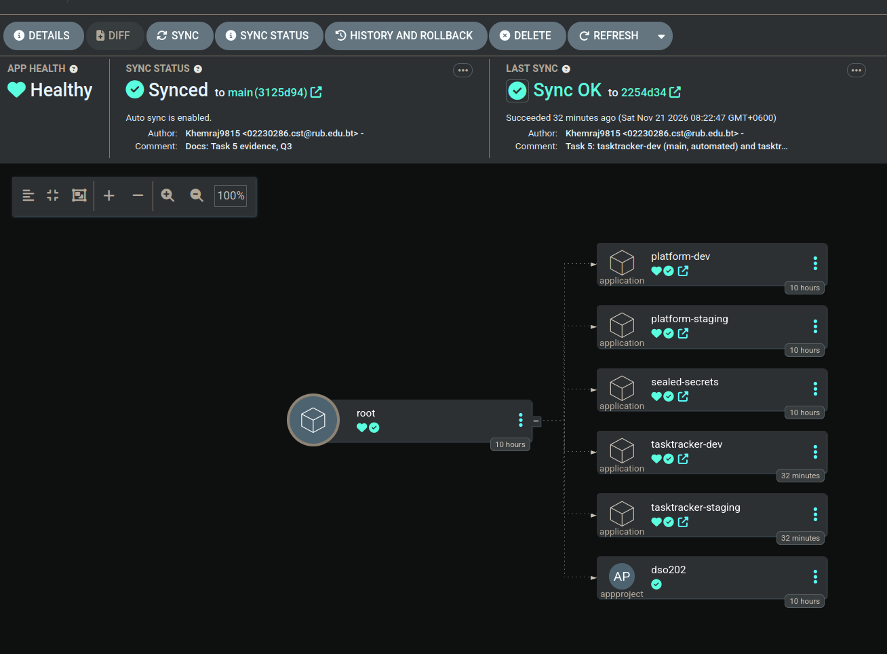
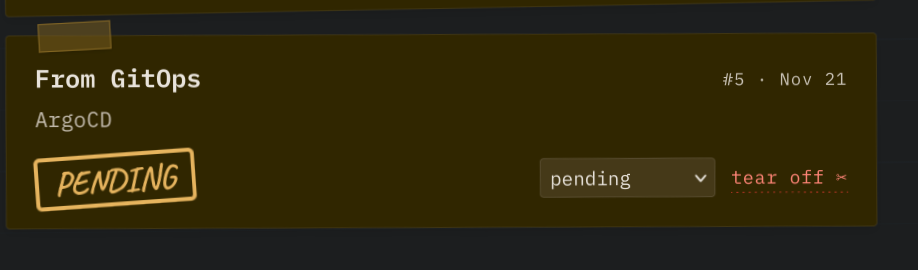

<!--
=============================================================================
File        : docs/evidence.md
Assignment  : DSO202 Assignment 4
Descriptor  : Section 9 - evidence convention
Purpose     : Command output for every task, one heading per task. Each block
              shows the command that was run, then its output. Credential
              values and key material never appear here.
=============================================================================
-->
# Evidence - dso202-gitops

## Task 1

### 1.1 Tool check (section 3.2)
```text
$ docker version --format '{{.Server.Version}}'
28.4.0

$ kind version
kind v0.20.0 go1.20.4 linux/amd64

$ kubectl version --client
Client Version: v1.34.1
Kustomize Version: v5.7.1

$ helm version --short
v4.3.0+gbec5b06

$ git --version
git version 2.43.0

$ argocd version --client
argocd: v3.5.6+c2b1e30
  BuildDate: 2026-10-20T19:01:52Z
  GitCommit: c2b1e3017e2cec86b122172e861dcd026453ae44
  GitTreeState: clean
  GoVersion: go1.26.10
  Compiler: gc
  Platform: linux/amd64

$ kubeseal --version
kubeseal version: 0.40.0

$ helm repo add sealed-secrets https://bitnami.github.io/sealed-secrets
"sealed-secrets" has been added to your repositories

$ helm repo update sealed-secrets
Hang tight while we grab the latest from your chart repositories...
...Successfully got an update from the "sealed-secrets" chart repository
Update Complete. ⎈Happy Helming!⎈

$ helm search repo sealed-secrets/sealed-secrets --versions | head -5
NAME                         	CHART VERSION	APP VERSION	DESCRIPTION                                  
sealed-secrets/sealed-secrets	2.22.0       	0.41.2     	Helm chart for the sealed-secrets controller.
sealed-secrets/sealed-secrets	2.21.0       	0.41.2     	Helm chart for the sealed-secrets controller.
sealed-secrets/sealed-secrets	2.20.0       	0.40.0     	Helm chart for the sealed-secrets controller.
sealed-secrets/sealed-secrets	2.19.3       	0.39.1     	Helm chart for the sealed-secrets controller.

```

### 1.2 Chart contract
| # | Requirement | Where it is satisfied (file → key) |
|---|---|---|
| C1 | Image repository and tag are values per tier | `charts/tasktracker/values.yaml` → `database/backend/frontend.image.repository`, `.image.tag`; used in `templates/database-statefulset.yaml`, `backend-deployment.yaml`, `frontend-deployment.yaml`. No tag appears in any template. |
| C2 | Per-tier configuration from values | `values.yaml` → `<tier>.env` (a map, so an environment file can add one key without repeating the others); rendered by `templates/_helpers.tpl` → `tasktracker.env` |
| C3 | No `Secret` rendered; credentials from `existingSecret` | `values.yaml` → `existingSecret: tasktracker-credentials`, `<tier>.secretEnv`; `_helpers.tpl` → `secretKeyRef.name`. No template renders `kind: Secret`. |
| C4 | Readiness probes on all three tiers | `values.yaml` → `database.readinessProbe` (`pg_isready`), `backend.readinessProbe` (`GET /api/status`), `frontend.readinessProbe` (`GET /`) |
| C5 | Sync waves database 0, backend 1, frontend 2 | `values.yaml` → `<tier>.syncWave`; `metadata.annotations["argocd.argoproj.io/sync-wave"]` in each workload template |
| C6 | `progressDeadlineSeconds: 120` | `values.yaml` → `backend/frontend.progressDeadlineSeconds`; `spec.progressDeadlineSeconds` in both Deployment templates |
| C7 | Requests and limits on every container | `values.yaml` → `<tier>.resources`; smoke-test Job declares its own (Task 5) |
| C8 | No Namespace/ResourceQuota/LimitRange/Role/RoleBinding in the chart | rendered kinds in 1.3 are only Deployment, Service, StatefulSet; those kinds live in `platform/<env>/` |
| C9 | Ingress disabled by default | `values.yaml` → `ingress.enabled: false`; `templates/ingress.yaml` wrapped in `if .Values.ingress.enabled` |
| C10 | Frontend Service is NodePort, port is a value | `values.yaml` → `frontend.service.type: NodePort`, `frontend.service.nodePort`; `environments/dev/values.yaml` 30080, `environments/staging/values.yaml` 30081 |
| C11 | `helm lint` clean, `helm template` succeeds | see 1.3 |

### 1.3 helm lint and rendered kinds
```text
$ helm lint charts/tasktracker -f environments/dev/values.yaml
==> Linting charts/tasktracker
[INFO] Chart.yaml: icon is recommended

1 chart(s) linted, 0 chart(s) failed

$ helm lint charts/tasktracker -f environments/staging/values.yaml
==> Linting charts/tasktracker
[INFO] Chart.yaml: icon is recommended

1 chart(s) linted, 0 chart(s) failed

$ helm template tasktracker charts/tasktracker -f environments/dev/values.yaml | grep '^kind:' | sort | uniq -c
      2 kind: Deployment
      3 kind: Service
      1 kind: StatefulSet

```

### 1.4 Cluster
```text
$ kind get clusters
dso202-gitops

$ kubectl config current-context
kind-dso202-gitops

$ kubectl get nodes
NAME            STATUS   ROLES           AGE     VERSION
control-plane   Ready    control-plane   3m4s    v1.36.1
worker-node-1   Ready    <none>          2m54s   v1.36.1

$ docker ps --filter name=dso202-gitops --format '{{.Names}}   {{.Ports}}'
dso202-gitops-worker   
dso202-gitops-control-plane   127.0.0.1:30080->30080/tcp, 127.0.0.1:30090->30090/tcp, 127.0.0.1:39157->6443/tcp

```

The last line shows host port 30080 (dev frontend) and 30090 (dev backend API) mapped on the control-plane node.

## Task 2

### 2.1 Render checks, install, pods, CRDs, local settings, version
```text
$ kubectl kustomize bootstrap/argocd | grep -E '^kind: (Deployment|StatefulSet)$' | sort | uniq -c
      6 kind: Deployment
      1 kind: StatefulSet

$ kubectl kustomize bootstrap/argocd | grep 'image:' | sort -u
        image: ghcr.io/dexidp/dex:v2.45.1
        image: public.ecr.aws/docker/library/redis:8.2.3-alpine
        image: quay.io/argoproj/argocd:v3.5.6

$ kubectl wait --for=condition=Available deployment --all -n argocd --timeout=300s
deployment.apps/argocd-applicationset-controller condition met
deployment.apps/argocd-dex-server condition met
deployment.apps/argocd-notifications-controller condition met
deployment.apps/argocd-redis condition met
deployment.apps/argocd-repo-server condition met
deployment.apps/argocd-server condition met

$ kubectl rollout status statefulset/argocd-application-controller -n argocd --timeout=300s
partitioned roll out complete: 1 new pods have been updated...

$ kubectl get pods -n argocd
NAME                                                READY   STATUS    RESTARTS   AGE
argocd-application-controller-0                     1/1     Running   0          38s
argocd-applicationset-controller-58bb5c7479-kx2r2   1/1     Running   0          48s
argocd-dex-server-dd6b85d9c-9n8rl                   1/1     Running   0          48s
argocd-notifications-controller-6b85c65458-t6s4q    1/1     Running   0          48s
argocd-redis-869b85489d-kngpg                       1/1     Running   0          48s
argocd-repo-server-5bf66565cd-25rlv                 1/1     Running   0          48s
argocd-server-7474bb8f76-8wrxf                      1/1     Running   0          48s

$ kubectl get crd | grep argoproj.io
applications.argoproj.io      2026-11-20T14:51:17Z
applicationsets.argoproj.io   2026-11-20T14:51:17Z
appprojects.argoproj.io       2026-11-20T14:51:18Z

$ kubectl get configmap argocd-cm -n argocd -o yaml | grep -E 'timeout.reconciliation|accounts.reviewer'
  accounts.reviewer: login
  timeout.reconciliation: 60s
  timeout.reconciliation.jitter: 10s

$ argocd admin initial-password -n argocd
<password printed - not recorded>

$ argocd login localhost:8080 --username admin --insecure
'admin:login' logged in successfully

$ argocd version
argocd: v3.5.6+c2b1e30
  BuildDate: 2026-10-20T19:01:52Z
  GitCommit: c2b1e3017e2cec86b122172e861dcd026453ae44
  GitTreeState: clean
  GoVersion: go1.26.10
  Compiler: gc
  Platform: linux/amd64
argocd-server: v3.5.6
  BuildDate: 2026-10-20T18:33:20Z
  GitCommit: c2b1e3017e2cec86b122172e861dcd026453ae44
  GitTreeState: clean
  GitTag: v3.5.6
  GoVersion: go1.26.10
  Compiler: gc
  Platform: linux/amd64
  Kustomize Version: v5.8.1 2026-02-09T16:15:27Z
  Helm Version: v4.2.1+gd591a19
  Kubectl Version: v0.36.1
  Jsonnet Version: v0.22.0

```

### 2.2 Screenshot


## Task 3

### 3.1 Whitelist compared with the chart
Rendered kinds (Task 1, 1.3): `Deployment` x2, `Service` x3, `StatefulSet` x1, plus the PostSync `Job` (Task 5).
Final `namespaceResourceWhitelist` in `argocd/projects/dso202.yaml`: `apps/Deployment`, `apps/StatefulSet`, `""/Service`, `batch/Job`.
Change from Listing 8: `ConfigMap` and `ServiceAccount` **removed** (the chart renders neither; a wider whitelist than needed is unused privilege). Nothing added. `Namespace`, `ResourceQuota`, `LimitRange`, `Role`, `RoleBinding`, `SealedSecret` are absent, as required.

### 3.2 Bootstrap and result
```text
$ kubectl apply -f bootstrap/root
appproject.argoproj.io/platform unchanged
application.argoproj.io/root unchanged

$ kubectl get appproject,application -n argocd
NAME                              AGE
appproject.argoproj.io/default    62s
appproject.argoproj.io/dso202     10s
appproject.argoproj.io/platform   15s

NAME                           SYNC STATUS   HEALTH STATUS
application.argoproj.io/root   Synced        Healthy

$ argocd app get root
Name:               argocd/root
Project:            platform
Server:             https://kubernetes.default.svc
Namespace:          argocd
URL:                https://localhost:8080/applications/root
Source:
- Repo:             https://github.com/Khemraj9815/dso202-gitops.git
  Target:           main
  Path:             argocd
SyncWindow:         Sync Allowed
Sync Policy:        Automated (Prune)
Sync Status:        Synced to main (e2cfff4)
Health Status:      Healthy

GROUP        KIND        NAMESPACE  NAME    STATUS  HEALTH  HOOK  MESSAGE
argoproj.io  AppProject  argocd     dso202  Synced                appproject.argoproj.io/dso202 unchanged

$ argocd proj get dso202
Name:                        dso202
Description:                 Task Tracker workloads for the dev and staging environments
Destinations:                https://kubernetes.default.svc,dso202-dev
                             https://kubernetes.default.svc,dso202-staging
Repositories:                https://github.com/Khemraj9815/dso202-gitops.git
Source Namespaces:           <none>
Scoped Repositories:         <none>
Allowed Cluster Resources:   <none>
Scoped Clusters:             <none>
Denied Namespaced Resources: <none>
Signature keys:              <none>
Orphaned Resources:          disabled

```
`dso202` appears in the resource list of `root`: it was created by the root Application, not by hand.

### 3.3 Screenshot



## Task 4

### 4.1 Controller installed from Git (step 1)
```text
$ kubectl get applications -n argocd
NAME             SYNC STATUS   HEALTH STATUS
root             Synced        Healthy
sealed-secrets   Synced        Healthy

$ kubectl get pods -n sealed-secrets
NAME                                        READY   STATUS    RESTARTS   AGE
sealed-secrets-controller-8b5ffdf69-fcdnq   1/1     Running   0          13s

$ kubectl get crd sealedsecrets.bitnami.com
NAME                        CREATED AT
sealedsecrets.bitnami.com   2026-11-20T16:39:50Z

```

### 4.2 Sealing-key backup (step 2) - existence and permissions only
```text
$ ls -l ../dso202-keys/
total 8
-rw------- 1 khemrajghalley khemrajghalley 7088 Nov 20 22:40 sealing-key.backup.yaml

$ grep -c 'tls.key' ../dso202-keys/sealing-key.backup.yaml
1

```
The backup is outside the repository, mode 600, and taken before anything was sealed. Its contents are never shown.

### 4.3 Sealing (steps 3-4)
Plaintext inputs `secrets-plain/dev.env` and `secrets-plain/staging.env` were written in an editor (mode 600, ignored by Git), checked for matching `DB_*`/`POSTGRES_*` values and for different dev/staging passwords, then sealed per namespace:
```bash
export SEALED_SECRETS_CONTROLLER_NAMESPACE=sealed-secrets
kubectl create secret generic tasktracker-credentials --namespace dso202-dev \
  --from-env-file=secrets-plain/dev.env --dry-run=client -o yaml \
  | kubeseal --format yaml > platform/dev/tasktracker-credentials.sealed.yaml
# repeated with dso202-staging / secrets-plain/staging.env / platform/staging/...
```

### 4.4 Platform layer delivered (step 6)
```text
$ kubectl get applications -n argocd
NAME               SYNC STATUS   HEALTH STATUS
platform-dev       Synced        Healthy
platform-staging   Synced        Healthy
root               Synced        Healthy
sealed-secrets     Synced        Healthy

$ kubectl get namespaces | grep dso202
dso202-dev           Active   8h
dso202-staging       Active   8h

$ kubectl get sealedsecret -n dso202-dev
NAME                      STATUS   SYNCED   AGE
tasktracker-credentials            True     8h

$ kubectl describe secret tasktracker-credentials -n dso202-dev
Name:         tasktracker-credentials
Namespace:    dso202-dev
Labels:       <none>
Annotations:  <none>

Type:  Opaque

Data
====
DB_PASSWORD:        6 bytes
DB_USER:            6 bytes
POSTGRES_PASSWORD:  6 bytes
POSTGRES_USER:      6 bytes

$ kubectl get resourcequota,limitrange,role,rolebinding -n dso202-dev
NAME                               REQUEST                                                LIMIT                                   AGE
resourcequota/app-resource-quota   pods: 0/8, requests.cpu: 0/2, requests.memory: 0/2Gi   limits.cpu: 0/4, limits.memory: 0/4Gi   8h

NAME                         CREATED AT
limitrange/app-limit-range   2026-11-20T16:56:19Z

NAME                                                CREATED AT
role.rbac.authorization.k8s.io/tasktracker-viewer   2026-11-20T16:56:19Z

NAME                                                               ROLE                      AGE
rolebinding.rbac.authorization.k8s.io/tasktracker-viewer-binding   Role/tasktracker-viewer   8h

$ kubectl get sealedsecret -n dso202-staging
NAME                      STATUS   SYNCED   AGE
tasktracker-credentials            True     8h

$ kubectl describe secret tasktracker-credentials -n dso202-staging
Name:         tasktracker-credentials
Namespace:    dso202-staging
Labels:       <none>
Annotations:  <none>

Type:  Opaque

Data
====
DB_PASSWORD:        9 bytes
DB_USER:            9 bytes
POSTGRES_PASSWORD:  9 bytes
POSTGRES_USER:      9 bytes

$ kubectl get resourcequota,limitrange,role,rolebinding -n dso202-staging
NAME                               REQUEST                                                LIMIT                                   AGE
resourcequota/app-resource-quota   pods: 0/8, requests.cpu: 0/2, requests.memory: 0/2Gi   limits.cpu: 0/4, limits.memory: 0/4Gi   8h

NAME                         CREATED AT
limitrange/app-limit-range   2026-11-20T16:56:20Z

NAME                                                CREATED AT
role.rbac.authorization.k8s.io/tasktracker-viewer   2026-11-20T16:56:20Z

NAME                                                               ROLE                      AGE
rolebinding.rbac.authorization.k8s.io/tasktracker-viewer-binding   Role/tasktracker-viewer   8h

$ argocd app get platform-dev
{"level":"fatal","msg":"Failed to establish connection to localhost:8080: error dial proxy: dial tcp 127.0.0.1:8080: connect: connection refused","time":"2026-11-21T07:50:47+06:00"}

```
Both `platform-*` Applications are `Synced` and `Healthy`; `tasktracker-credentials` exists in both namespaces with the four keys (sizes only, never values), created by the controller from the SealedSecret.

### 4.5 No plaintext in Git history (step 7)
Keys tested, in both environments, each in plain **and** base64 form: `DB_USER`, `DB_PASSWORD`, `POSTGRES_USER`, `POSTGRES_PASSWORD` (16 searches). Values are not recorded.
```text
$ git log -p --all -S'<dev DB_USER, plain>' | head
(no output)
$ git log -p --all -S'<dev DB_USER, base64>' | head
(no output)
$ git log -p --all -S'<dev DB_PASSWORD, plain>' | head
(no output)
$ git log -p --all -S'<dev DB_PASSWORD, base64>' | head
(no output)
$ git log -p --all -S'<dev POSTGRES_USER, plain>' | head
(no output)
$ git log -p --all -S'<dev POSTGRES_USER, base64>' | head
(no output)
$ git log -p --all -S'<dev POSTGRES_PASSWORD, plain>' | head
(no output)
$ git log -p --all -S'<dev POSTGRES_PASSWORD, base64>' | head
(no output)
$ git log -p --all -S'<staging DB_USER, plain>' | head
(no output)
$ git log -p --all -S'<staging DB_USER, base64>' | head
(no output)
$ git log -p --all -S'<staging DB_PASSWORD, plain>' | head
(no output)
$ git log -p --all -S'<staging DB_PASSWORD, base64>' | head
(no output)
$ git log -p --all -S'<staging POSTGRES_USER, plain>' | head
(no output)
$ git log -p --all -S'<staging POSTGRES_USER, base64>' | head
(no output)
$ git log -p --all -S'<staging POSTGRES_PASSWORD, plain>' | head
(no output)
$ git log -p --all -S'<staging POSTGRES_PASSWORD, base64>' | head
(no output)

$ git status --short --ignored
 M docs/evidence.md
!! secrets-plain/
```
Every search printed nothing. The only ignored path is `secrets-plain/`.

## Task 5

### 5.1 Baseline tag
```text
$ git ls-remote --tags origin
a354888643ae0f50a400cf7939ae61e5b067dca2	refs/tags/v1.0.0
c512c4580b20734a12afb73f1d4dac3fe9fb6aca	refs/tags/v1.0.0^{}
```
`v1.0.0` points at `c512c45` ("Task 5: PostSync smoke-test hook"), which contains the chart, the smoke test and `environments/staging/values.yaml`. The Applications were added in the next commit (`2254d34`).

### 5.2 Wave order in dev (step 4)
`kubectl get pods -n dso202-dev -w`, each line prefixed with the time it was printed (repeated lines removed):
```text
08:22:48 NAME                     READY   STATUS    RESTARTS   AGE
08:22:48 tasktracker-database-0   0/1     Pending   0          0s
08:22:51 tasktracker-database-0   0/1     ContainerCreating   0          3s
08:22:52 tasktracker-database-0   0/1     Running             0          4s
08:22:57 tasktracker-database-0   1/1     Running             0          9s
08:22:57 tasktracker-backend-797ccb7c6c-xw47n   0/1     Pending             0          0s
08:22:58 tasktracker-backend-797ccb7c6c-xw47n   0/1     ContainerCreating   0          1s
08:22:58 tasktracker-backend-797ccb7c6c-xw47n   0/1     Running             0          1s
08:23:03 tasktracker-backend-797ccb7c6c-xw47n   1/1     Running             0          6s
08:23:03 tasktracker-frontend-66ccd9ff45-vzpqm   0/1     Pending             0          0s
08:23:04 tasktracker-frontend-66ccd9ff45-vzpqm   0/1     ContainerCreating   0          0s
08:23:04 tasktracker-frontend-66ccd9ff45-vzpqm   0/1     Running             0          1s
08:23:09 tasktracker-frontend-66ccd9ff45-vzpqm   1/1     Running             0          6s
08:23:09 tasktracker-smoke-test-7bxng            0/1     Pending             0          0s
08:23:09 tasktracker-smoke-test-7bxng            0/1     ContainerCreating   0          0s
08:23:11 tasktracker-smoke-test-7bxng            1/1     Running             0          2s
08:23:12 tasktracker-smoke-test-7bxng            0/1     Completed           0          3s
```
Each wave starts only when the previous one is **ready**: database ready 08:22:57 -> backend created 08:22:57; backend ready 08:23:03 -> frontend created 08:23:03; frontend ready 08:23:09 -> PostSync smoke-test Job created 08:23:09, completed 08:23:12.

`kubectl get applications -n argocd -w` over the same period (repeated lines removed):
```text
08:21:08 NAME               SYNC STATUS   HEALTH STATUS
08:21:08 platform-dev       Synced        Healthy
08:21:08 platform-staging   Synced        Healthy
08:21:08 root               Synced        Healthy
08:21:08 sealed-secrets     Synced        Healthy
08:22:40 root               OutOfSync     Healthy
08:22:47 tasktracker-dev                  
08:22:47 tasktracker-staging                 
08:22:47 root                  Synced        Progressing
08:22:48 tasktracker-dev       OutOfSync     Missing
08:22:48 tasktracker-staging   OutOfSync     Missing
08:22:48 tasktracker-dev       OutOfSync     Healthy
08:22:48 tasktracker-dev       OutOfSync     Progressing
08:23:04 tasktracker-dev       Synced        Progressing
08:23:09 tasktracker-dev       Synced        Healthy
08:24:01 tasktracker-staging   OutOfSync     Progressing
08:24:12 tasktracker-staging   OutOfSync     Healthy
08:24:18 tasktracker-staging   Synced        Progressing
08:24:24 tasktracker-staging   Synced        Healthy
```

### 5.3 Smoke test and dev Application
```text
$ kubectl get job -n dso202-dev
NAME                     STATUS     COMPLETIONS   DURATION   AGE
tasktracker-smoke-test   Complete   1/1           5s         17s

$ kubectl logs job/tasktracker-smoke-test -n dso202-dev
[{"id":1,"title":"Set up kind cluster","description":"Bring up the local cluster from Practical 1","status":"done","created_at":"2026-11-21T02:22:54.567Z"},{"id":2,"title":"Write namespace manifest","description":"One namespace for all assignment resources","status":"in_progress","created_at":"2026-11-21T02:22:54.567Z"},{"id":3,"title":"Wire ConfigMap and Secret","description":"DB_* and POSTGRES_* must carry matching values","status":"pending","created_at":"2026-11-21T02:22:54.567Z"}]
$ argocd app get tasktracker-dev
Name:               argocd/tasktracker-dev
Project:            dso202
Server:             https://kubernetes.default.svc
Namespace:          dso202-dev
URL:                https://localhost:8080/applications/tasktracker-dev
Source:
- Repo:             https://github.com/Khemraj9815/dso202-gitops.git
  Target:           main
  Path:             charts/tasktracker
  Helm Values:      ../../environments/dev/values.yaml
SyncWindow:         Sync Allowed
Sync Policy:        Automated (Prune)
Sync Status:        Synced to main (2254d34)
Health Status:      Healthy

GROUP  KIND         NAMESPACE   NAME                    STATUS     HEALTH   HOOK      MESSAGE
       Service      dso202-dev  tasktracker-database    Synced     Healthy            service/tasktracker-database created
apps   StatefulSet  dso202-dev  tasktracker-database    Synced     Healthy            statefulset rolling update complete 1 pods at revision tasktracker-database-6b756cf8f4...
       Service      dso202-dev  tasktracker-backend     Synced     Healthy            service/tasktracker-backend created
apps   Deployment   dso202-dev  tasktracker-backend     Synced     Healthy            deployment.apps/tasktracker-backend created
       Service      dso202-dev  tasktracker-frontend    Synced     Healthy            service/tasktracker-frontend created
apps   Deployment   dso202-dev  tasktracker-frontend    Synced     Healthy            deployment.apps/tasktracker-frontend created
batch  Job          dso202-dev  tasktracker-smoke-test  Succeeded  Synced   PostSync  Reached expected number of succeeded pods

```

### 5.4 CRUD cycle in dev (backend API at http://localhost:30090, the address the frontend at http://localhost:30080 calls)
```text
$ curl -s -o /dev/null -w 'frontend HTTP %{http_code}\n' http://localhost:30080/
frontend HTTP 200

$ curl -s http://localhost:30080/config.js
// Rendered at container start by docker-entrypoint.sh via envsubst.
// Static assets can't read environment variables at request time, so the
// real value gets baked into config.js once, right before nginx starts.
window.__CONFIG__ = {
  BACKEND_URL: "http://localhost:30090"
};

$ curl -s http://localhost:30090/api/status
{"status":"ok","db":"connected"}
$ curl -s -X POST -H 'Content-Type: application/json' -d '{"title":"CRUD test (Task 5)","description":"created through the dev API"}' http://localhost:30090/api/tasks
{"id":4,"title":"CRUD test (Task 5)","description":"created through the dev API","status":"pending","created_at":"2026-11-21T02:23:26.908Z"}
$ curl -s http://localhost:30090/api/tasks/4
{"id":4,"title":"CRUD test (Task 5)","description":"created through the dev API","status":"pending","created_at":"2026-11-21T02:23:26.908Z"}
$ curl -s -X PUT -H 'Content-Type: application/json' -d '{"title":"CRUD test (Task 5)","status":"done"}' http://localhost:30090/api/tasks/4
{"id":4,"title":"CRUD test (Task 5)","description":"created through the dev API","status":"done","created_at":"2026-11-21T02:23:26.908Z"}
$ curl -s -o /dev/null -w 'DELETE HTTP %{http_code}\n' -X DELETE http://localhost:30090/api/tasks/4
DELETE HTTP 204

$ curl -s -o /dev/null -w 'GET after delete HTTP %{http_code}\n' http://localhost:30090/api/tasks/4
GET after delete HTTP 404

```
Create (201, id 4) -> read -> update (status `done`) -> delete (204) -> read again (404). The same cycle was also performed in the browser at http://localhost:30080 (screenshot below).



### 5.5 Staging: before the first sync
```text
$ kubectl get applications -n argocd
NAME                  SYNC STATUS   HEALTH STATUS
platform-dev          Synced        Healthy
platform-staging      Synced        Healthy
root                  Synced        Healthy
sealed-secrets        Synced        Healthy
tasktracker-dev       Synced        Healthy
tasktracker-staging   OutOfSync     Missing

$ argocd app get tasktracker-staging
Name:               argocd/tasktracker-staging
Project:            dso202
Server:             https://kubernetes.default.svc
Namespace:          dso202-staging
URL:                https://localhost:8080/applications/tasktracker-staging
Source:
- Repo:             https://github.com/Khemraj9815/dso202-gitops.git
  Target:           v1.0.0
  Path:             charts/tasktracker
  Helm Values:      ../../environments/staging/values.yaml
SyncWindow:         Sync Allowed
Sync Policy:        Manual
Sync Status:        OutOfSync from v1.0.0 (c512c45)
Health Status:      Missing

GROUP  KIND         NAMESPACE       NAME                  STATUS     HEALTH   HOOK  MESSAGE
       Service      dso202-staging  tasktracker-backend   OutOfSync  Missing        
       Service      dso202-staging  tasktracker-database  OutOfSync  Missing        
       Service      dso202-staging  tasktracker-frontend  OutOfSync  Missing        
apps   Deployment   dso202-staging  tasktracker-backend   OutOfSync  Missing        
apps   Deployment   dso202-staging  tasktracker-frontend  OutOfSync  Missing        
apps   StatefulSet  dso202-staging  tasktracker-database  OutOfSync  Missing        

$ argocd app get root | sed -n '/Health Status/,$p'
Health Status:      Healthy

GROUP        KIND         NAMESPACE  NAME                 STATUS  HEALTH   HOOK  MESSAGE
argoproj.io  Application  argocd     tasktracker-staging  Synced  Missing        application.argoproj.io/tasktracker-staging unchanged
argoproj.io  Application  argocd     tasktracker-dev      Synced  Healthy        application.argoproj.io/tasktracker-dev unchanged
argoproj.io  AppProject   argocd     dso202               Synced                 
argoproj.io  Application  argocd     platform-dev         Synced  Healthy        
argoproj.io  Application  argocd     platform-staging     Synced  Healthy        
argoproj.io  Application  argocd     sealed-secrets       Synced  Healthy        

```

### 5.6 Staging: manual sync and access
```text
$ argocd app sync tasktracker-staging --timeout 400
TIMESTAMP                  GROUP        KIND    NAMESPACE                      NAME    STATUS    HEALTH        HOOK  MESSAGE
2026-11-21T08:24:01+06:00            Service   dso202-staging   tasktracker-backend  OutOfSync  Missing              
2026-11-21T08:24:01+06:00            Service   dso202-staging  tasktracker-database  OutOfSync  Missing              
2026-11-21T08:24:01+06:00            Service   dso202-staging  tasktracker-frontend  OutOfSync  Missing              
2026-11-21T08:24:01+06:00   apps  Deployment   dso202-staging   tasktracker-backend  OutOfSync  Missing              
2026-11-21T08:24:01+06:00   apps  Deployment   dso202-staging  tasktracker-frontend  OutOfSync  Missing              
2026-11-21T08:24:01+06:00   apps  StatefulSet  dso202-staging  tasktracker-database  OutOfSync  Missing              
2026-11-21T08:24:01+06:00   apps  StatefulSet  dso202-staging  tasktracker-database    Synced  Progressing              
2026-11-21T08:24:01+06:00            Service   dso202-staging  tasktracker-database    Synced  Healthy                  
2026-11-21T08:24:03+06:00            Service   dso202-staging  tasktracker-database    Synced  Healthy                  service/tasktracker-database created
2026-11-21T08:24:03+06:00   apps  StatefulSet  dso202-staging  tasktracker-database    Synced  Progressing              statefulset.apps/tasktracker-database created
2026-11-21T08:24:12+06:00   apps  StatefulSet  dso202-staging  tasktracker-database    Synced  Healthy              statefulset.apps/tasktracker-database created
2026-11-21T08:24:12+06:00            Service  dso202-staging   tasktracker-backend    Synced  Healthy              
2026-11-21T08:24:12+06:00   apps  Deployment  dso202-staging   tasktracker-backend    Synced  Progressing              
2026-11-21T08:24:14+06:00   apps  StatefulSet  dso202-staging  tasktracker-database    Synced  Healthy                  statefulset rolling update complete 1 pods at revision tasktracker-database-6b756cf8f4...
2026-11-21T08:24:14+06:00            Service   dso202-staging   tasktracker-backend    Synced  Healthy                  service/tasktracker-backend created
2026-11-21T08:24:14+06:00   apps  Deployment   dso202-staging   tasktracker-backend    Synced  Progressing              deployment.apps/tasktracker-backend created
2026-11-21T08:24:18+06:00   apps  Deployment  dso202-staging   tasktracker-backend    Synced  Healthy              deployment.apps/tasktracker-backend created
2026-11-21T08:24:18+06:00            Service  dso202-staging  tasktracker-frontend    Synced  Healthy              
2026-11-21T08:24:18+06:00   apps  Deployment  dso202-staging  tasktracker-frontend    Synced  Progressing              
2026-11-21T08:24:20+06:00            Service  dso202-staging  tasktracker-frontend    Synced  Healthy                  service/tasktracker-frontend created
2026-11-21T08:24:20+06:00   apps  Deployment  dso202-staging  tasktracker-frontend    Synced  Progressing              deployment.apps/tasktracker-frontend created
2026-11-21T08:24:24+06:00   apps  Deployment  dso202-staging  tasktracker-frontend    Synced  Healthy              deployment.apps/tasktracker-frontend created
2026-11-21T08:24:24+06:00  batch         Job  dso202-staging  tasktracker-smoke-test   Running   Synced    PostSync  job.batch/tasktracker-smoke-test created
2026-11-21T08:24:28+06:00  batch         Job  dso202-staging  tasktracker-smoke-test  Succeeded   Synced    PostSync  Reached expected number of succeeded pods

Name:               argocd/tasktracker-staging
Project:            dso202
Server:             https://kubernetes.default.svc
Namespace:          dso202-staging
URL:                https://localhost:8080/applications/tasktracker-staging
Source:
- Repo:             https://github.com/Khemraj9815/dso202-gitops.git
  Target:           v1.0.0
  Path:             charts/tasktracker
  Helm Values:      ../../environments/staging/values.yaml
SyncWindow:         Sync Allowed
Sync Policy:        Manual
Sync Status:        Synced to v1.0.0 (c512c45)
Health Status:      Healthy

Operation:          Sync
Sync Revision:      c512c4580b20734a12afb73f1d4dac3fe9fb6aca
Phase:              Succeeded
Start:              2026-11-21 08:24:01 +0600 +06
Finished:           2026-11-21 08:24:28 +0600 +06
Duration:           27s
Message:            successfully synced (no more tasks)

GROUP  KIND         NAMESPACE       NAME                    STATUS     HEALTH   HOOK      MESSAGE
       Service      dso202-staging  tasktracker-database    Synced     Healthy            service/tasktracker-database created
apps   StatefulSet  dso202-staging  tasktracker-database    Synced     Healthy            statefulset rolling update complete 1 pods at revision tasktracker-database-6b756cf8f4...
       Service      dso202-staging  tasktracker-backend     Synced     Healthy            service/tasktracker-backend created
apps   Deployment   dso202-staging  tasktracker-backend     Synced     Healthy            deployment.apps/tasktracker-backend created
       Service      dso202-staging  tasktracker-frontend    Synced     Healthy            service/tasktracker-frontend created
apps   Deployment   dso202-staging  tasktracker-frontend    Synced     Healthy            deployment.apps/tasktracker-frontend created
batch  Job          dso202-staging  tasktracker-smoke-test  Succeeded  Synced   PostSync  Reached expected number of succeeded pods

$ argocd app get root --refresh | sed -n '/Health Status/,$p'
Health Status:      Healthy

GROUP        KIND         NAMESPACE  NAME                 STATUS  HEALTH   HOOK  MESSAGE
argoproj.io  Application  argocd     tasktracker-staging  Synced  Healthy        application.argoproj.io/tasktracker-staging unchanged
argoproj.io  Application  argocd     tasktracker-dev      Synced  Healthy        application.argoproj.io/tasktracker-dev unchanged
argoproj.io  AppProject   argocd     dso202               Synced                 
argoproj.io  Application  argocd     platform-dev         Synced  Healthy        
argoproj.io  Application  argocd     platform-staging     Synced  Healthy        
argoproj.io  Application  argocd     sealed-secrets       Synced  Healthy        

$ kubectl get applications -n argocd
NAME                  SYNC STATUS   HEALTH STATUS
platform-dev          Synced        Healthy
platform-staging      Synced        Healthy
root                  Synced        Healthy
sealed-secrets        Synced        Healthy
tasktracker-dev       Synced        Healthy
tasktracker-staging   Synced        Healthy

$ kubectl get svc -n dso202-staging
NAME                   TYPE        CLUSTER-IP      EXTERNAL-IP   PORT(S)        AGE
tasktracker-backend    ClusterIP   10.96.165.19    <none>        8080/TCP       33s
tasktracker-database   ClusterIP   10.96.102.197   <none>        5432/TCP       44s
tasktracker-frontend   NodePort    10.96.37.211    <none>        80:30081/TCP   27s

$ kubectl port-forward -n dso202-staging svc/tasktracker-frontend 8081:80      # own terminal
$ kubectl port-forward -n dso202-staging svc/tasktracker-backend 8091:8080   # own terminal

$ curl -s -o /dev/null -w 'staging frontend HTTP %{http_code}\n' http://localhost:8081/
staging frontend HTTP 200

$ curl -s http://localhost:8081/config.js | grep BACKEND_URL
  BACKEND_URL: "http://localhost:8091"

$ curl -s http://localhost:8091/api/status
{"status":"ok","db":"connected"}
$ kubectl logs job/tasktracker-smoke-test -n dso202-staging
[{"id":1,"title":"Set up kind cluster","description":"Bring up the local cluster from Practical 1","status":"done","created_at":"2026-11-21T02:24:08.364Z"},{"id":2,"title":"Write namespace manifest","description":"One namespace for all assignment resources","status":"in_progress","created_at":"2026-11-21T02:24:08.364Z"},{"id":3,"title":"Wire ConfigMap and Secret","description":"DB_* and POSTGRES_* must carry matching values","status":"pending","created_at":"2026-11-21T02:24:08.364Z"}]
```

### 5.7 State of `root` before and after the first staging sync
| | `tasktracker-staging` row in `argocd app get root` | `root` health |
|---|---|---|
| Before sync (5.5) | `Synced`, health **`Missing`** | `Healthy` |
| After sync (5.6) | `Synced`, health **`Healthy`** | `Healthy` |

The restored health check (Listing 4) works: the child's own health (`Missing`, then `Healthy`) is reported upward into the root's resource list. Observed difference from the brief: in Argo CD v3.5.6 the root's *aggregate* health stayed `Healthy` before the first staging sync, because Argo CD ignores resources whose health is `Missing` when it aggregates an Application's health; a `Missing` child is shown but does not degrade the parent. During the dev rollout, where the child was `Progressing`, the root did report `Synced / Progressing` (5.2, 08:22:47), showing that non-Missing child health does propagate.

### 5.8 Screenshot


