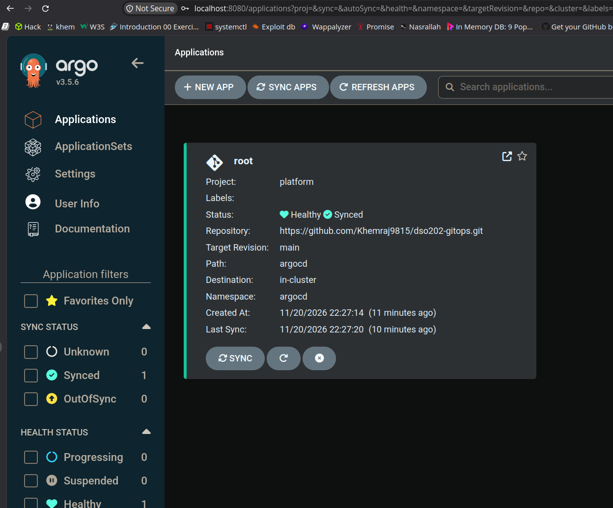

<!--
=============================================================================
File        : docs/evidence.md
Assignment  : DSO202 Assignment 4
Descriptor  : Section 9 - evidence convention
Purpose     : Command output for every task, one heading per task. Each block
              shows the command that was run, then its output. Credential
              values and key material never appear here.
=============================================================================
-->
# Evidence - dso202-gitops

## Task 1

### 1.1 Tool check (section 3.2)
```text
$ docker version --format '{{.Server.Version}}'
28.4.0

$ kind version
kind v0.20.0 go1.20.4 linux/amd64

$ kubectl version --client
Client Version: v1.34.1
Kustomize Version: v5.7.1

$ helm version --short
v4.3.0+gbec5b06

$ git --version
git version 2.43.0

$ argocd version --client
argocd: v3.5.6+c2b1e30
  BuildDate: 2026-10-20T19:01:52Z
  GitCommit: c2b1e3017e2cec86b122172e861dcd026453ae44
  GitTreeState: clean
  GoVersion: go1.26.10
  Compiler: gc
  Platform: linux/amd64

$ kubeseal --version
kubeseal version: 0.40.0

$ helm repo add sealed-secrets https://bitnami.github.io/sealed-secrets
"sealed-secrets" has been added to your repositories

$ helm repo update sealed-secrets
Hang tight while we grab the latest from your chart repositories...
...Successfully got an update from the "sealed-secrets" chart repository
Update Complete. ⎈Happy Helming!⎈

$ helm search repo sealed-secrets/sealed-secrets --versions | head -5
NAME                         	CHART VERSION	APP VERSION	DESCRIPTION                                  
sealed-secrets/sealed-secrets	2.22.0       	0.41.2     	Helm chart for the sealed-secrets controller.
sealed-secrets/sealed-secrets	2.21.0       	0.41.2     	Helm chart for the sealed-secrets controller.
sealed-secrets/sealed-secrets	2.20.0       	0.40.0     	Helm chart for the sealed-secrets controller.
sealed-secrets/sealed-secrets	2.19.3       	0.39.1     	Helm chart for the sealed-secrets controller.

```

### 1.2 Chart contract
| # | Requirement | Where it is satisfied (file → key) |
|---|---|---|
| C1 | Image repository and tag are values per tier | `charts/tasktracker/values.yaml` → `database/backend/frontend.image.repository`, `.image.tag`; used in `templates/database-statefulset.yaml`, `backend-deployment.yaml`, `frontend-deployment.yaml`. No tag appears in any template. |
| C2 | Per-tier configuration from values | `values.yaml` → `<tier>.env` (a map, so an environment file can add one key without repeating the others); rendered by `templates/_helpers.tpl` → `tasktracker.env` |
| C3 | No `Secret` rendered; credentials from `existingSecret` | `values.yaml` → `existingSecret: tasktracker-credentials`, `<tier>.secretEnv`; `_helpers.tpl` → `secretKeyRef.name`. No template renders `kind: Secret`. |
| C4 | Readiness probes on all three tiers | `values.yaml` → `database.readinessProbe` (`pg_isready`), `backend.readinessProbe` (`GET /api/status`), `frontend.readinessProbe` (`GET /`) |
| C5 | Sync waves database 0, backend 1, frontend 2 | `values.yaml` → `<tier>.syncWave`; `metadata.annotations["argocd.argoproj.io/sync-wave"]` in each workload template |
| C6 | `progressDeadlineSeconds: 120` | `values.yaml` → `backend/frontend.progressDeadlineSeconds`; `spec.progressDeadlineSeconds` in both Deployment templates |
| C7 | Requests and limits on every container | `values.yaml` → `<tier>.resources`; smoke-test Job declares its own (Task 5) |
| C8 | No Namespace/ResourceQuota/LimitRange/Role/RoleBinding in the chart | rendered kinds in 1.3 are only Deployment, Service, StatefulSet; those kinds live in `platform/<env>/` |
| C9 | Ingress disabled by default | `values.yaml` → `ingress.enabled: false`; `templates/ingress.yaml` wrapped in `if .Values.ingress.enabled` |
| C10 | Frontend Service is NodePort, port is a value | `values.yaml` → `frontend.service.type: NodePort`, `frontend.service.nodePort`; `environments/dev/values.yaml` 30080, `environments/staging/values.yaml` 30081 |
| C11 | `helm lint` clean, `helm template` succeeds | see 1.3 |

### 1.3 helm lint and rendered kinds
```text
$ helm lint charts/tasktracker -f environments/dev/values.yaml
==> Linting charts/tasktracker
[INFO] Chart.yaml: icon is recommended

1 chart(s) linted, 0 chart(s) failed

$ helm lint charts/tasktracker -f environments/staging/values.yaml
==> Linting charts/tasktracker
[INFO] Chart.yaml: icon is recommended

1 chart(s) linted, 0 chart(s) failed

$ helm template tasktracker charts/tasktracker -f environments/dev/values.yaml | grep '^kind:' | sort | uniq -c
      2 kind: Deployment
      3 kind: Service
      1 kind: StatefulSet

```

### 1.4 Cluster
```text
$ kind get clusters
dso202-gitops

$ kubectl config current-context
kind-dso202-gitops

$ kubectl get nodes
NAME            STATUS   ROLES           AGE     VERSION
control-plane   Ready    control-plane   3m4s    v1.36.1
worker-node-1   Ready    <none>          2m54s   v1.36.1

$ docker ps --filter name=dso202-gitops --format '{{.Names}}   {{.Ports}}'
dso202-gitops-worker   
dso202-gitops-control-plane   127.0.0.1:30080->30080/tcp, 127.0.0.1:30090->30090/tcp, 127.0.0.1:39157->6443/tcp

```

The last line shows host port 30080 (dev frontend) and 30090 (dev backend API) mapped on the control-plane node.

## Task 2

### 2.1 Render checks, install, pods, CRDs, local settings, version
```text
$ kubectl kustomize bootstrap/argocd | grep -E '^kind: (Deployment|StatefulSet)$' | sort | uniq -c
      6 kind: Deployment
      1 kind: StatefulSet

$ kubectl kustomize bootstrap/argocd | grep 'image:' | sort -u
        image: ghcr.io/dexidp/dex:v2.45.1
        image: public.ecr.aws/docker/library/redis:8.2.3-alpine
        image: quay.io/argoproj/argocd:v3.5.6

$ kubectl wait --for=condition=Available deployment --all -n argocd --timeout=300s
deployment.apps/argocd-applicationset-controller condition met
deployment.apps/argocd-dex-server condition met
deployment.apps/argocd-notifications-controller condition met
deployment.apps/argocd-redis condition met
deployment.apps/argocd-repo-server condition met
deployment.apps/argocd-server condition met

$ kubectl rollout status statefulset/argocd-application-controller -n argocd --timeout=300s
partitioned roll out complete: 1 new pods have been updated...

$ kubectl get pods -n argocd
NAME                                                READY   STATUS    RESTARTS   AGE
argocd-application-controller-0                     1/1     Running   0          38s
argocd-applicationset-controller-58bb5c7479-kx2r2   1/1     Running   0          48s
argocd-dex-server-dd6b85d9c-9n8rl                   1/1     Running   0          48s
argocd-notifications-controller-6b85c65458-t6s4q    1/1     Running   0          48s
argocd-redis-869b85489d-kngpg                       1/1     Running   0          48s
argocd-repo-server-5bf66565cd-25rlv                 1/1     Running   0          48s
argocd-server-7474bb8f76-8wrxf                      1/1     Running   0          48s

$ kubectl get crd | grep argoproj.io
applications.argoproj.io      2026-11-20T14:51:17Z
applicationsets.argoproj.io   2026-11-20T14:51:17Z
appprojects.argoproj.io       2026-11-20T14:51:18Z

$ kubectl get configmap argocd-cm -n argocd -o yaml | grep -E 'timeout.reconciliation|accounts.reviewer'
  accounts.reviewer: login
  timeout.reconciliation: 60s
  timeout.reconciliation.jitter: 10s

$ argocd admin initial-password -n argocd
<password printed - not recorded>

$ argocd login localhost:8080 --username admin --insecure
'admin:login' logged in successfully

$ argocd version
argocd: v3.5.6+c2b1e30
  BuildDate: 2026-10-20T19:01:52Z
  GitCommit: c2b1e3017e2cec86b122172e861dcd026453ae44
  GitTreeState: clean
  GoVersion: go1.26.10
  Compiler: gc
  Platform: linux/amd64
argocd-server: v3.5.6
  BuildDate: 2026-10-20T18:33:20Z
  GitCommit: c2b1e3017e2cec86b122172e861dcd026453ae44
  GitTreeState: clean
  GitTag: v3.5.6
  GoVersion: go1.26.10
  Compiler: gc
  Platform: linux/amd64
  Kustomize Version: v5.8.1 2026-02-09T16:15:27Z
  Helm Version: v4.2.1+gd591a19
  Kubectl Version: v0.36.1
  Jsonnet Version: v0.22.0

```

### 2.2 Screenshot



## Task 3

### 3.1 Whitelist compared with the chart
Rendered kinds (Task 1, 1.3): `Deployment` x2, `Service` x3, `StatefulSet` x1, plus the PostSync `Job` (Task 5).
Final `namespaceResourceWhitelist` in `argocd/projects/dso202.yaml`: `apps/Deployment`, `apps/StatefulSet`, `""/Service`, `batch/Job`.
Change from Listing 8: `ConfigMap` and `ServiceAccount` **removed** (the chart renders neither; a wider whitelist than needed is unused privilege). Nothing added. `Namespace`, `ResourceQuota`, `LimitRange`, `Role`, `RoleBinding`, `SealedSecret` are absent, as required.

### 3.2 Bootstrap and result
```text
$ kubectl apply -f bootstrap/root
appproject.argoproj.io/platform unchanged
application.argoproj.io/root unchanged

$ kubectl get appproject,application -n argocd
NAME                              AGE
appproject.argoproj.io/default    62s
appproject.argoproj.io/dso202     10s
appproject.argoproj.io/platform   15s

NAME                           SYNC STATUS   HEALTH STATUS
application.argoproj.io/root   Synced        Healthy

$ argocd app get root
Name:               argocd/root
Project:            platform
Server:             https://kubernetes.default.svc
Namespace:          argocd
URL:                https://localhost:8080/applications/root
Source:
- Repo:             https://github.com/Khemraj9815/dso202-gitops.git
  Target:           main
  Path:             argocd
SyncWindow:         Sync Allowed
Sync Policy:        Automated (Prune)
Sync Status:        Synced to main (e2cfff4)
Health Status:      Healthy

GROUP        KIND        NAMESPACE  NAME    STATUS  HEALTH  HOOK  MESSAGE
argoproj.io  AppProject  argocd     dso202  Synced                appproject.argoproj.io/dso202 unchanged

$ argocd proj get dso202
Name:                        dso202
Description:                 Task Tracker workloads for the dev and staging environments
Destinations:                https://kubernetes.default.svc,dso202-dev
                             https://kubernetes.default.svc,dso202-staging
Repositories:                https://github.com/Khemraj9815/dso202-gitops.git
Source Namespaces:           <none>
Scoped Repositories:         <none>
Allowed Cluster Resources:   <none>
Scoped Clusters:             <none>
Denied Namespaced Resources: <none>
Signature keys:              <none>
Orphaned Resources:          disabled

```
`dso202` appears in the resource list of `root`: it was created by the root Application, not by hand.

### 3.3 Screenshot


